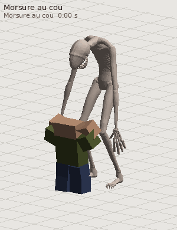
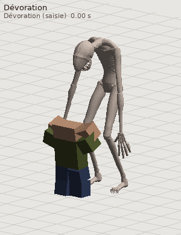

# Le monstre du jeu de survie : modèle Blender, export Roblox, rapport

Branche `monstre-blender`. Modèle, textures (sang compris), rendus et export sont faits dans Blender 5.2 (module
`bpy`, sans interface) ; les animations (déplacement et 8 mises à mort) sont calculées en Python, et le paquet Roblox
(`monstre/roblox/`) monte le rig, anime le monstre et ses victimes, et déroule les mises à mort en jeu. L'installation
dans Roblox Studio se fait chez l'utilisateur, en trois gestes ou par Claude en local (`monstre/CLAUDE.md`).


## 1. Demandes et évolution

1. Tâche de départ (`monstre/TACHE_MONSTRE.md`) : le monstre de tendons noirs de `monstre/reference.webp`, fait
   dans Blender, avec les contraintes Roblox (rig rigide de 37 pièces, 20 000 triangles au plus par maillage).
   Une première version « tendons noirs » a été faite (brins torsadés, filaments qui gouttent, racines) ; elle a été
   remplacée à la demande de l'utilisateur et n'est pas livrée (son générateur reste dans `mon_body.py`).
2. Demande suivante : « fais un truc beaucoup plus réaliste avec de vraies textures ! (fais tout sur Blender) ».
   Peau, matières et éclairage réalistes, textures cuites dans Blender.
3. Puis, avec une image (créature humanoïde pâle, nue, décharnée, aux membres démesurés, dans une pièce sombre en
   bois, conservée dans `monstre/reference_style_utilisateur.png`) : « fais un truc plus dans ce style ». Le monstre
   est devenu une **créature en peau réaliste**. De la référence d'origine, on garde la posture voûtée, la tête
   basse projetée vers l'avant, lisse, allongée et sans yeux, la fente de gueule aux crocs fins avec la lueur
   orangée, les bras qui pendent jusqu'aux genoux et les longs doigts griffus. Les racines des pieds sont devenues
   de longs pieds osseux griffus ; les tendons noirs et les filaments ont disparu au profit de la peau.
4. Enfin : « rajoute des meilleures textures, des trucs très réalistes que tu peux créer, générer ou trouver sur
   internet, mais des vraies textures ». La peau mêle maintenant de **vraies textures de peau scannée** (grain de
   couleur, pores, ridules et plis, brillance d'un scan de tête humaine, voir § 5) aux couches procédurales.
5. Puis : « rajoute des textures de sang dessus. Fais ses animations gore » (morsure au cou, morsure répétée,
   dévoration, attaque au ventre, traînée, « extraction » suggérée, frénésie, victime contaminée), « ainsi que la
   marche, course, saut etc. et importe-la dans Roblox ». Le sang est cuit dans les textures (§ 6) ; 21 animations du
   monstre et 13 de la victime (§ 7) ; un paquet Roblox complet (§ 8). Une session dans le cloud ne peut pas agir dans
   le Studio de l'utilisateur : l'import se fait chez lui (`monstre/roblox/LISEZMOI.md`, trois gestes) ou par Claude
   en local avec le serveur MCP de Studio (`monstre/CLAUDE.md`).

## 2. Rendus (`monstre/rendus/`, Cycles, 1024 × 1536)

Toutes les vues montrent le sang cuit dans les textures (§ 6) : gueule et menton, mains et griffes, coulures et
éclaboussures sur les bras, le torse et les jambes.

| Fichier | Vue |
|---|---|
| `trois_quarts.png` | trois quarts face, comme la référence, fond clair et brumeux (posture de repos, mâchoire un peu plus ouverte) |
| `face.png`, `profil.png`, `dos.png` | face, profil, dos (posture de repos) |
| `tete.png` | gros plan de la tête et de la gueule |
| `main.png` | gros plan de la main droite |
| `trois_quarts_sombre.png`, `tete_sombre.png` | dans une pièce sombre en bois, comme l'image de style de l'utilisateur (même posture) |
| `pliage.png` | contrôle : articulations franchement pliées (manchons) |
| `animations/*.gif` | les 8 mises à mort et le déplacement, animés (aperçu rapide, § 7) |
| `apercu_morts_1.jpg`, `apercu_morts_2.jpg`, `apercu_deplacement.jpg` | planches Cycles des animations (§ 7) |

## 3. Versions et environnement

- Blender **5.2.3 LTS** en module Python (`bpy` 5.2.3), Python 3.13.17, numpy 2.5.4, scipy 1.18.1, Pillow 13.0.0.
- Rendus et cuissons : Cycles CPU (4 cœurs, pas de GPU), débruitage OpenImageDenoise, transformée de vue AgX
  (« Medium High Contrast »).
- L'environnement Python est hors du dépôt (voir `monstre/blender/scripts/README.md`).

## 4. Méthode

1. **Squelette** (`mon_skel.py`) : pivots, repère de tête et découpage du prototype (`J`, `FH`/`UH`, `rig_spec()`,
   37 pièces), agrandis d'un facteur 1,32.
2. **Anatomie** (`mon_flesh.py`, repère Roblox) : surfaces balayées à profil anatomique pour le tronc (section avec
   colonne en creux, ventre creusé sous les côtes) et les membres (quadriceps, ischio-jambiers, mollet, deltoïde,
   biceps, triceps, fléchisseurs…), et des formes simples pour ce qui affleure sous la peau d'une créature affamée :
   10 paires de côtes irrégulières, rebord costal, sternum, vertèbres saillantes, omoplates (bord interne, épine),
   clavicules, crêtes et épines iliaques, rotules, tendons rotuliens, crêtes tibiales, malléoles, tendons d'Achille,
   tendons des poignets et du dos des mains et des pieds. Tête : crâne paramétrique sans yeux (orbites creuses,
   arcades, pommettes), gueule fendue au palais rouge sombre, 26 crocs en haut, 22 en bas, mâchoire séparée. Mains :
   paume, métacarpes, articulations, doigts en 2 segments, griffes noires à pointe claire ; pieds à 5 orteils griffus.
3. **Peau continue** (`mon_blend.gn_fuse`, Geometry Nodes) : toutes les formes du corps sont converties en une grille
   SDF (voxel 0,0105 stud), fermée (dilatation puis érosion de 0,035), congés (SDF Grid Fillet), puis remaillée et
   lissée (3 passes) ; couleur régionale, type de matière et direction des fibres reportés depuis les formes. Même
   chose pour chaque main (voxel 0,007) et pour la mâchoire. Ces peaux continues (≈ 2 millions de triangles) servent
   à la cuisson.
4. **Maillages de jeu** (`construire.py`, `mon_cut.py`) : la peau continue est décimée d'un bloc, puis découpée en
   pièces. Chaque sommet est rattaché à l'os le plus proche (distance normalisée par l'épaisseur du membre) et la
   frontière entre deux pièces suit la courbe où les deux distances sont égales : les triangles qui la traversent sont
   recoupés, ce qui donne des jointures régulières (pas de zigzag le long des arêtes). Deux pièces voisines partagent
   exactement les mêmes sommets de bord, avec les normales de la peau continue (normales personnalisées) : aucun
   raccord ne se voit au repos. Une pièce trop dense (cage thoracique) est redécimée seule, son bord verrouillé
   (aucun sommet du bord déplacé). Chaque jointure a un **manchon**, porté par la pièce enfant : la peau de la pièce
   parente (et des voisines qui ne sont pas ses enfants) près de la frontière, rentrée de 0,012 stud sous la surface ;
   il suit l'enfant et comble le vide quand l'articulation plie. Griffes et crocs sont des maillages séparés dans la
   même pièce.
5. **Textures** (`cuire_textures.py`, `mon_skin.py`, `mon_tex.py`) : dépliage Smart UV Project par maillage, puis
   cuisson Cycles « sélection vers actif » depuis la peau continue : couleur (16 échantillons), rugosité, normale en
   espace tangent (4 échantillons). La matière de la peau haute définition mêle :
   - de **vraies textures de peau** (§ 5) en projection triplanaire : grain de couleur (deux motifs, deux échelles,
     mélangés par un bruit pour casser la répétition), relief des pores, ridules et plis (deux motifs), brillance ;
   - des couches procédurales à l'échelle du corps : marbrures, rougeurs aux articulations, ecchymoses, veines
     bleutées, crasse dans les plis (occlusion), terre sur les pieds et le bas des jambes, griffures sombres, rides et
     plis alignés sur les membres ; crocs jaunis, gencives rouge sombre, griffes noires à pointe claire.
   Taille des images : 256 à 1024 px selon la surface (≈ 300 px par stud, 1024 px au plus, la limite de Roblox).
6. **Rendus** (`rendus.py`, `mon_scene2.py`) : brume claire (ciel clair, sol qui se fond dans la brume, brume
   volumique, soleil et contre-jour) et intérieur sombre en planches (lampe chaude, contre-jour froid). Diffusion
   sous la peau (rendu seulement) ; lueur orangée dans la gueule (sphère émissive et lampe ponctuelle, parentées à la
   tête), à l'endroit du marqueur `GLOW_MOUTH`.

## 5. Vraies textures : source, licence, méthode

- Source : **« Infinite, 3D Head Scan » de Lee Perry-Smith**, Infinite-Realities (http://www.ir-ltd.net/), d'après
  un travail sur www.triplegangers.com, licence **Creative Commons Attribution 3.0 (CC BY 3.0)**. Fichiers utilisés :
  la carte de couleur (`Map-COL.jpg`), la carte spéculaire (`Map-SPEC.jpg`) et la carte de relief 4096 px
  (`Infinite-Level_02_Disp_NoSmoothUV-4096.jpg`), distribués avec three.js (`examples/models/gltf/LeePerrySmith/`).
- Méthode (`scripts/textures_reelles.py`) : zones de peau propre seulement (haut du crâne, cou, nuque ; ni barbe, ni
  yeux, ni oreilles), passe-haut (le grain reste, l'éclairage et la forme du visage partent), raccord sans couture
  (mélange avec la copie décalée d'une demi-période, pondération qui garde le contraste). Résultat dans
  `monstre/blender/textures_reelles/` : 2 motifs de couleur, 2 de relief (16 bits), 1 de brillance.
- Échelle : un motif couvre 0,7 à 1,25 stud sur le monstre ; le grain est donc agrandi par rapport à une peau humaine
  (créature de plus de 10 studs, textures de jeu à ≈ 300 px par stud), pour rester lisible dans Roblox.
- **Crédit obligatoire** dans le jeu (licence CC BY) : « Détail de peau : Infinite, 3D Head Scan by Lee Perry-Smith
  (Infinite-Realities), CC BY 3.0 ».
- Les grandes bibliothèques de textures libres (ambientcg.com, polyhaven.com, 3dtextures.me, cgbookcase.com,
  texture.ninja, commons.wikimedia.org) n'étaient pas joignables depuis l'environnement de travail (politique réseau) ;
  les fichiers bruts de GitHub l'étaient, d'où ce scan distribué avec three.js.

## 6. Sang

Le monstre vient de dévorer quelqu'un : le sang est **cuit dans les textures** (couleur, rugosité, relief), comme le
reste de la peau, donc il est aussi dans Roblox.

1. **Où** (`mon_sang.py`) : deux attributs par sommet sur la peau haute définition, `Sang` (quantité) et `SangFrais`
   (1 frais et mouillé, 0 séché). Sources : lèvres, gencives et crocs, menton et gorge (la mâchoire entière est
   ensanglantée), mains et griffes imbibées, avant-bras, éclaboussures sur le torse, les bras et les cuisses, pieds qui
   ont marché dedans. Les **coulures** partent de ces zones et descendent de sommet en sommet le long de la plus forte
   pente (un peu de hasard), s'amincissent et finissent par une goutte. Surface couverte : 8,2 % du corps, 27 à 28 %
   des mains, toute la mâchoire. Tirages fixés (graine par zone) : le résultat est reproductible.
2. **Matière** (`mon_skin.py`, cuite par `cuire_textures.py`) : deux bruits découpent le bord des taches ; couche
   épaisse (rouge très sombre quand elle est fraîche, brun-rouge mat quand elle a séché, noircie là où elle est
   épaisse), auréole teintée autour, rugosité de 0,07 (frais, brillant) à 0,58 (sec), relief : épaisseur en surépaisseur
   et craquelures de croûte (cellules de Voronoï).
3. **Décalques pour le jeu** (`sang_decals.py`) : flaque, trois éclaboussures, traînée raccordable (bande de 4 × 1),
   sang sur l'écran et goutte pour les particules, en couleur avec transparence, rugosité et relief. Ils sont exportés
   comme 7 plans `SANG_*` posés à côté du monstre dans le FBX et le GLB : l'import de Roblox téléverse leurs textures,
   l'installateur les range comme gabarits (`ReplicatedStorage.Monstre.Effets`, transparence par l'alpha) et le jeu les
   copie au sol (flaques qui s'étendent, éclaboussures, traînée), devant la caméra de la victime, et en particules.

## 7. Animations

Calculées en Python (`mon_anim.py`, `mon_clips.py`, `mon_morts.py`) sur le rig rigide de 37 pièces, plus une pièce
`VictimeAncre` (enfant du HumanoidRootPart) qui porte la victime pendant une mise à mort.

- **Cadre** : cinématique directe ; IK des jambes à pieds plantés (le lacet du bassin est compensé, roulis pour l'écart
  latéral, pieds tenus à plat ou au pitch voulu) ; IK des bras (paume sur un point, coude orienté) ; pistes à clés
  lissées (Hermite monotone) ; pas et demi-tours sur place (pieds en arcs autour de l'axe du corps).
- **Déplacement et gestes** (9 clips) : repos (respiration, regard qui balaie, doigts qui se crispent), marche
  (5,5 studs/s) et course (20 studs/s) à pieds plantés (le pied recule exactement à la vitesse du clip), saut, chute
  (bras qui battent), atterrissage, hurlement, flairer, attaque.
- **Victime** : le rig du survivant R6 articulé (`src/anim.py` du projet, lu sans être modifié). Son HumanoidRootPart
  est soudé à `VictimeAncre` ; la piste de l'ancre la colle à la gueule (morsures) ou à une paume (saisies), la pose
  au sol (son point le plus bas posé sur le sol), ou la fait traîner par la cheville (tangage calculé pour que la tête
  et le dos frottent le sol). Ses propres animations (lutte, corps mou, chute, mort) sont des clips du survivant.
- **Les 8 mises à mort** (12 clips appariés monstre + victime, 2,2 à 5,4 s) :

| Mise à mort | Phases (clips) | Moments clés (marqueurs) |
|---|---|---|
| 🩸 Morsure au cou | `k_cou` 3,6 s | saisie par les épaules (IK des deux mains), soulevée jusqu'à la gueule ; morsure à 1,05 s avec coupure au noir de 0,4 s, éclaboussures, sang sur l'écran ; tête qui secoue ; corps lâché (2,42 s), flaque sous le cou |
| 🦷 Morsure répétée | `k_repetee` 3,4 s | tenue d'une main par l'épaule ; morsures à 0,85, 1,2, 1,55 et 1,9 s (la victime est tirée vers la gueule) ; jetée sur le côté à 2,3 s |
| 👹 Dévoration | `k_dev_saisie` 2,9 s, `k_dev_trainer` (boucle 3 s), `k_dev_tourner` 2,2 s, `k_dev_manger` (boucle 2,4 s) | renversée, saisie par la cheville, demi-tour ; traînée (marche penchée à reculons du HumanoidRootPart, corps tourné de 180°, traînée de sang) ; se retourne, s'agenouille, la soulève et la dévore (mastication, arrachements) |
| 💀 Attaque au ventre | `k_ventre` 3,3 s | élan ; griffes dans le ventre à 0,56 s (la victime est soulevée, IK de la main dans le torse) ; torsion ; retrait à 1,4 s ; elle se plie, tombe à genoux puis sur le côté |
| 🩸 Traînée | `k_trainee_saisie` 2,7 s, `k_trainee_trainer` (boucle 2 s) | comme la dévoration mais la victime est vivante (elle s'agrippe au sol, se débat) et tirée vite (8 studs/s) hors de la pièce ; longue traînée de sang |
| 🫀 Extraction | `k_extraction` 5,4 s | plaquée au sol (main gauche sur la poitrine), il s'agenouille et fouille (main droite qui plonge et tire, IK) ; caméra derrière son épaule à 1,2 s ; coupure au noir d'1 s à 3,8 s ; il se relève, la main à la gueule |
| 🐺 Frénésie | `k_frenesie` 3,8 s | renversée ; 12 coups et morsures de 0,62 à 2,38 s (pulsations d'IK des mains et de la gueule), caméra qui tremble ; à 2,65 s, silence soudain de 2,5 s et il se fige |
| ☣️ Contamination | `k_contamination` 2,8 s | saisie par l'avant-bras, morsure à 0,72 s (marqueur `Infection`), jetée à 1,35 s ; elle finit face contre terre dans la pose « allongé » du survivant, d'où elle se relève (clip `getup`) |

Aperçus (victime figurée par des boîtes aux proportions et aux couleurs du survivant) : **GIF animés**
`rendus/animations/<mise à mort>.gif` (les 8 mises à mort, phases enchaînées, sol qui défile à la vitesse du clip,
traînée de sang au sol pendant les traînées) et `rendus/animations/deplacement.gif` (repos, marche, course, saut,
chute, atterrissage, hurlement, flairer, attaque), faits avec le moteur d'aperçu rapide (`gif_morts.py`) ; planches
Cycles `rendus/apercu_morts_1.jpg`, `rendus/apercu_morts_2.jpg`, `rendus/apercu_deplacement.jpg`.

 

Pour Roblox (`exporter_roblox.py`) : échantillonnage à 30 images/s, clés réduites **piste par piste** (garder les
clés dont l'interpolation s'écarte de plus de 0,5 degré ou 5 mm ; 0,8 degré pour les doigts), quantification (temps
en ms, quaternion et translation sur 16 bits), base64. Résultat : 13 364 clés pour le monstre (21 clips) et 4 720 pour
la victime (13 clips), 281 Ko de données ; écart maximal avec le calcul d'origine : 0,8 degré.

## 8. Paquet Roblox (`monstre/roblox/`, détails dans `roblox/LISEZMOI.md`)

- **Installation** : *Importer 3D* de `export/Monstre.fbx`, insertion du kit `roblox/Monstre_Kit.rbxmx`, puis
  `require(workspace.Monstre_Kit.Installateur)()` dans la barre de commande. L'installateur retrouve échelle et
  orientation par les marqueurs, remet le modèle à l'échelle 1 et debout, monte le rig (HumanoidRootPart, 38 Motor6D
  aux pivots, Humanoid R15 HipHeight 5,928, lueur de la gueule), range les gabarits de sang et installe les scripts.
- **Animation sans AnimationTrack** : chaque client calcule les poses depuis `MonstreDonnees` et écrit
  `Motor6D.Transform` (après l'Animator) ; rien à publier, et la victime est animée par-dessus les animations du
  survivant. Les phases sont synchronisées sur l'horloge du serveur (`workspace:GetServerTimeNow()`).
- **IA** (serveur) : patrouille (points étiquetés ou au hasard), vue (70 studs, champ de 140°, ligne de vue) et ouïe
  (joueur qui court à 26 studs), hurlement, poursuite par recherche de chemin, mise à mort à 5,5 studs (tirage pondéré,
  jamais deux fois la même de suite), destinations des traînées (`MonstreTaniere`, `MonstreSortie`), cadavre posé
  (copie ancrée de la tenue, sans l'anatomie), mort et réapparition du joueur, infection.
- **Client** : caméra de la victime (vue subjective, plans de côté, par-dessus l'épaule de la victime ou du monstre,
  à distance, traînée, cadavre), coupures au noir, tremblements, sang sur l'écran, sang au sol (flaques qui
  s'étendent, éclaboussures, traînées dans le sens du déplacement), particules, sons 3D, silence, symptômes de
  l'infection (couleurs, flou au rythme du cœur, voile, toux, caméra qui tangue, vitesse réduite) ; commandes coupées
  pendant la mise à mort.
- **Sons** : 19 sons synthétisés (`sons_monstre.py` : sources glottiques graves à formants et grain irrégulier pour
  les grognements et hurlements, bruits filtrés et clics résonants pour morsures, déchirures, craquements, mastication,
  bruits sourds pour pas, impacts et chutes, battements de cœur, toux), `roblox/sons/*.ogg`, à importer dans Roblox
  (identifiants à reporter dans `MonstreConfig`).
- **Tests hors ligne** (`roblox/test/`) : émulation de l'API Roblox (copie étendue de celle du survivant :
  ordonnanceur à coroutines, attributs, étiquettes, recherche de chemin, sons, particules, caméra, solveur de joints),
  `luaurun test/rbx_mock.lua test/test_monstre.lua` : **220 vérifications, 0 échec** — installation sur un import
  penché, tourné et à l'échelle 0,01 (et refus d'un import en miroir ou sans marqueur), décodage des pistes identique
  au Python, chaîne complète (installateur + lecteur + victime soudée + joints) à moins de 2 millièmes de stud des
  positions calculées en Python, le monstre qui repère, hurle, poursuit et attaque le joueur, puis chacune des 8 mises
  à mort de bout en bout (phases, caméra, coupure au noir, sang, traînée alignée, cadavre au sol avec la tenue,
  infection et relevé), sans erreur.

## 9. Maillages

| Maillage | Pièce | Parent | Triangles | Textures (px) |
|---|---|---|---:|---:|
| `MON_Pelvis_1` | Pelvis | HumanoidRootPart | 12 922 | 1024 |
| `MON_Abdomen_1` | Abdomen | Pelvis | 12 157 | 1024 |
| `MON_Chest_1` | Chest | Abdomen | 18 999 | 1024 |
| `MON_UpperChest_1` | UpperChest | Chest | 19 000 | 1024 |
| `MON_Neck_1` | Neck | UpperChest | 5 841 | 512 |
| `MON_Head_1` | Head | Neck | 14 937 | 1024 |
| `MON_Jaw_1` | Jaw | Head | 5 000 | 512 |
| `MON_Thigh_R_1` | Thigh_R | Pelvis | 10 340 | 1024 |
| `MON_Shin_R_1` | Shin_R | Thigh_R | 9 387 | 1024 |
| `MON_Foot_R_1` | Foot_R | Shin_R | 7 010 | 512 |
| `MON_UpperArm_R_1` | UpperArm_R | UpperChest | 7 178 | 1024 |
| `MON_Forearm_R_1` | Forearm_R | UpperArm_R | 5 190 | 512 |
| `MON_Hand_R_1` | Hand_R | Forearm_R | 3 653 | 512 |
| `MON_Index1_R_1` | Index1_R | Hand_R | 1 406 | 256 |
| `MON_Index2_R_1` | Index2_R | Index1_R | 1 461 | 256 |
| `MON_Middle1_R_1` | Middle1_R | Hand_R | 1 496 | 256 |
| `MON_Middle2_R_1` | Middle2_R | Middle1_R | 1 613 | 256 |
| `MON_Ring1_R_1` | Ring1_R | Hand_R | 1 433 | 256 |
| `MON_Ring2_R_1` | Ring2_R | Ring1_R | 1 516 | 256 |
| `MON_Pinky1_R_1` | Pinky1_R | Hand_R | 1 346 | 256 |
| `MON_Pinky2_R_1` | Pinky2_R | Pinky1_R | 1 325 | 256 |
| `MON_Thumb1_R_1` | Thumb1_R | Hand_R | 1 688 | 256 |
| `MON_Thigh_L_1` | Thigh_L | Pelvis | 10 171 | 1024 |
| `MON_Shin_L_1` | Shin_L | Thigh_L | 9 337 | 1024 |
| `MON_Foot_L_1` | Foot_L | Shin_L | 6 946 | 512 |
| `MON_UpperArm_L_1` | UpperArm_L | UpperChest | 7 220 | 1024 |
| `MON_Forearm_L_1` | Forearm_L | UpperArm_L | 5 105 | 512 |
| `MON_Hand_L_1` | Hand_L | Forearm_L | 3 636 | 512 |
| `MON_Index1_L_1` | Index1_L | Hand_L | 1 424 | 256 |
| `MON_Index2_L_1` | Index2_L | Index1_L | 1 472 | 256 |
| `MON_Middle1_L_1` | Middle1_L | Hand_L | 1 489 | 256 |
| `MON_Middle2_L_1` | Middle2_L | Middle1_L | 1 616 | 256 |
| `MON_Ring1_L_1` | Ring1_L | Hand_L | 1 433 | 256 |
| `MON_Ring2_L_1` | Ring2_L | Ring1_L | 1 523 | 256 |
| `MON_Pinky1_L_1` | Pinky1_L | Hand_L | 1 354 | 256 |
| `MON_Pinky2_L_1` | Pinky2_L | Pinky1_L | 1 314 | 256 |
| `MON_Thumb1_L_1` | Thumb1_L | Hand_L | 1 669 | 256 |

Total : **200 607 triangles** en 37 maillages (un par pièce), de 1 314 à 19 000 par maillage (limite Roblox : 20 000). Les griffes et les crocs sont comptés avec leur pièce. Chaque maillage a ses trois images : `T_<Pièce>_1_Couleur.png`, `_Rugosite.png`, `_Normale.png` (intégrées au GLB, au FBX et au .blend).

## 10. Rig

Rig rigide sur mesure, hiérarchie et pivots de `rig_spec()` (repère Roblox, studs). La racine `HumanoidRootPart` est
au pivot du bassin. Dans `Monstre.blend`, un empty `RIG_<Pièce>` par pièce, placé au pivot de son articulation et
parenté à celui de la pièce parente ; les maillages sont parentés à l'empty de leur pièce (pose de repos). Tout est
dans `monstre/export/rig.json` (parent, pivot, nom de l'articulation, maillages et triangles de chaque pièce ; boîte
englobante, hauteur, marqueurs, position de la lueur, repère de la tête et charnière de la mâchoire).

| Pièce | Parent | Articulation | Pivot (X ; Y ; Z, studs) |
|---|---|---|---|
| Pelvis | HumanoidRootPart | Root | (0,000 ; 7,128 ; 0,290) |
| Abdomen | Pelvis | SpineLow | (0,000 ; 7,854 ; 0,317) |
| Chest | Abdomen | SpineMid | (0,000 ; 8,818 ; 0,158) |
| UpperChest | Chest | SpineHigh | (0,000 ; 9,610 ; -0,290) |
| Neck | UpperChest | NeckBase | (0,000 ; 10,296 ; -0,924) |
| Head | Neck | HeadJoint | (0,000 ; 10,085 ; -1,584) |
| Jaw | Head | JawHinge | (0,000 ; 9,873 ; -1,865) |
| Thigh_R | Pelvis | Hip_R | (0,660 ; 6,864 ; 0,290) |
| Shin_R | Thigh_R | Knee_R | (0,950 ; 3,986 ; -0,818) |
| Foot_R | Shin_R | Ankle_R | (1,135 ; 0,871 ; 0,290) |
| UpperArm_R | UpperChest | Shoulder_R | (1,294 ; 9,794 ; -0,581) |
| Forearm_R | UpperArm_R | Elbow_R | (1,980 ; 7,075 ; -1,030) |
| Hand_R | Forearm_R | Wrist_R | (2,455 ; 4,567 ; -1,373) |
| Index1_R | Hand_R | Index1Joint_R | (2,398 ; 3,741 ; -1,477) |
| Index2_R | Index1_R | Index2Joint_R | (2,182 ; 2,940 ; -1,134) |
| Middle1_R | Hand_R | Middle1Joint_R | (2,542 ; 3,709 ; -1,367) |
| Middle2_R | Middle1_R | Middle2Joint_R | (2,390 ; 2,784 ; -0,940) |
| Ring1_R | Hand_R | Ring1Joint_R | (2,679 ; 3,742 ; -1,258) |
| Ring2_R | Ring1_R | Ring2Joint_R | (2,563 ; 2,936 ; -0,769) |
| Pinky1_R | Hand_R | Pinky1Joint_R | (2,794 ; 3,838 ; -1,162) |
| Pinky2_R | Pinky1_R | Pinky2Joint_R | (2,711 ; 3,214 ; -0,682) |
| Thumb1_R | Hand_R | Thumb1Joint_R | (2,281 ; 4,314 ; -1,443) |
| Thigh_L | Pelvis | Hip_L | (-0,660 ; 6,864 ; 0,290) |
| Shin_L | Thigh_L | Knee_L | (-0,950 ; 3,986 ; -0,818) |
| Foot_L | Shin_L | Ankle_L | (-1,135 ; 0,871 ; 0,290) |
| UpperArm_L | UpperChest | Shoulder_L | (-1,294 ; 9,794 ; -0,581) |
| Forearm_L | UpperArm_L | Elbow_L | (-1,980 ; 7,075 ; -1,030) |
| Hand_L | Forearm_L | Wrist_L | (-2,455 ; 4,567 ; -1,373) |
| Index1_L | Hand_L | Index1Joint_L | (-2,398 ; 3,741 ; -1,477) |
| Index2_L | Index1_L | Index2Joint_L | (-2,182 ; 2,940 ; -1,134) |
| Middle1_L | Hand_L | Middle1Joint_L | (-2,542 ; 3,709 ; -1,367) |
| Middle2_L | Middle1_L | Middle2Joint_L | (-2,390 ; 2,784 ; -0,940) |
| Ring1_L | Hand_L | Ring1Joint_L | (-2,679 ; 3,742 ; -1,258) |
| Ring2_L | Ring1_L | Ring2Joint_L | (-2,563 ; 2,936 ; -0,769) |
| Pinky1_L | Hand_L | Pinky1Joint_L | (-2,794 ; 3,838 ; -1,162) |
| Pinky2_L | Pinky1_L | Pinky2Joint_L | (-2,711 ; 3,214 ; -0,682) |
| Thumb1_L | Hand_L | Thumb1Joint_L | (-2,281 ; 4,314 ; -1,443) |

Pour les mises à mort, l'installateur Roblox ajoute une 38e articulation, `VictimeAncre` (pièce invisible enfant du
HumanoidRootPart), qui porte la victime (§ 7 et § 8) ; elle n'est pas dans les fichiers exportés.

## 11. Repère, échelle et marqueurs

- 1 unité Blender = 1 stud. Repère Roblox : Y vers le haut, le monstre regarde vers −Z, sa droite est +X. Dans
  Blender : (x, y, z) Blender = (X, −Z, Y) Roblox (le monstre regarde vers +Y, Z vers le haut). Le GLB (Y en haut)
  et le FBX (axes « −Z avant, Y haut ») redonnent directement le repère Roblox.
- Marqueurs (cubes de 0,05 stud, nommés exactement) aux positions Roblox (X ; Y ; Z) : `REF_A` (0 ; 5 ; 0),
  `REF_B` (0 ; 7 ; 0), `REF_C` (1,5 ; 5 ; 0), `REF_D` (0 ; 5 ; −1), et `GLOW_MOUTH` (0,000 ; 9,024 ; -2,315) (au fond de la gueule,
  là où mettre la lueur, par exemple une petite part Neon orange et une PointLight, à souder à la tête).
- Hauteur du monstre dans sa posture voûtée : 10,61 studs (du sol au sommet du dos) ; la plante des pieds est
  vers Y = 0, les griffes des orteils descendent jusqu'à Y = -0,14.

## 12. Export

| Fichier | Contenu | Réglages |
|---|---|---|
| `export/Monstre.glb` | 37 maillages `MON_*` + 5 marqueurs + 7 gabarits de sang `SANG_*`, textures intégrées (couleur, normale, rugosité par maillage ; couleur avec transparence, normale, rugosité par gabarit) | glTF binaire, Y en haut, modificateurs appliqués, normales (personnalisées) et UV, matières exportées, images PNG intégrées, pas de couleurs de sommets |
| `export/Monstre.fbx` | les mêmes maillages, marqueurs et gabarits, textures intégrées | échelle 1, `FBX_SCALE_NONE`, axes −Z avant / Y haut, normales seules (pas de groupes de lissage), textures copiées et intégrées |
| `export/Monstre_couleurs_sommets.glb` | repli sans textures : couleurs des textures cuites dans les couleurs de sommets (sans gabarits de sang) | glTF binaire, couleurs de sommets actives |
| `export/rig.json` | rig, maillages, marqueurs | voir § 10 |
| `blender/Monstre.blend` | scène complète compressée : maillages, matières à textures (images empaquetées), rig d'empties, marqueurs, gabarits de sang (collection `MON_Sang_Gabarits`, cachée au rendu), scène de rendu prête (brume, lueur de la gueule, caméra trois quarts, Cycles) | la version haute définition de cuisson n'y est pas (elle se régénère) |

Les gabarits `SANG_Flaque`, `SANG_Eclaboussure_1` à `_3`, `SANG_Trainee` (bande de 4 × 1), `SANG_Ecran` et
`SANG_Goutte` sont des plans horizontaux posés à côté du monstre (§ 6) : *Importer 3D* en fait des MeshParts avec
SurfaceAppearance (textures téléversées avec le modèle), que l'installateur range dans
`ReplicatedStorage.Monstre.Effets`. À l'import dans Studio, les maillages du monstre deviennent des MeshParts avec
SurfaceAppearance ; chacun reste sous 20 000 triangles. L'installateur Roblox (§ 8) retrouve échelle et orientation
avec les marqueurs, crée les Motor6D et pose la lueur sur `GLOW_MOUTH`.

Vérification (`verifier_export.py`, réimport dans une scène Blender vide) :

```
Monstre.glb : 37 maillages MON_, 200607 triangles (max 19000), 37 matières, 132 images, hauteur 10.61 studs, 7 gabarits de sang
  OK : noms, limite de triangles, marqueurs, normales
Monstre.fbx : 37 maillages MON_, 200607 triangles (max 19000), 37 matières, 146 images, hauteur 10.61 studs, 7 gabarits de sang
  OK : noms, limite de triangles, marqueurs, normales
Monstre_couleurs_sommets.glb : 37 maillages MON_, 200607 triangles (max 19000), 1 matières, 0 images, hauteur 10.61 studs, 0 gabarits de sang
  OK : noms, limite de triangles, marqueurs, normales
VERIF OK
```

(Le contrôle vérifie aussi que chaque gabarit a ses textures et reste horizontal. Au réimport du FBX, Blender charge
trois fois l'image de couleur de chaque gabarit, qui porte aussi la transparence : 146 images au lieu de 132.)

Tailles : `Monstre.glb` 47,7 Mo, `Monstre.fbx` 48,3 Mo, `Monstre_couleurs_sommets.glb` 7,5 Mo, `Monstre.blend`
50,4 Mo. Boîte englobante du monstre (Roblox) : X de -2,85 à 2,85, Y de -0,14 à 10,61, Z de -3,34 à 0,79.

## 13. Comparaison avec les références

- **Image de style de l'utilisateur** : peau pâle et réaliste, créature nue, très maigre, membres démesurés, os qui
  affleurent ; même ambiance sombre (rendu `trois_quarts_sombre`). Le visage de l'image étant masqué, la tête vient
  de la référence d'origine.
- **Référence d'origine** : même silhouette (grand, voûté, dos rond, tête basse projetée vers l'avant, genoux un peu
  fléchis, bras jusqu'aux genoux, longs doigts griffus), tête lisse allongée sans yeux, fente de gueule aux crocs fins
  avec lueur orangée, fond clair et brumeux. Ce qui a changé à la demande de l'utilisateur : la matière (peau au lieu
  de tendons noirs mouillés), plus de filaments ni de trous, pieds griffus au lieu de racines.

## 14. Limites connues

- **Rig rigide** : chaque pièce bouge en bloc. Les manchons comblent les trous quand une articulation plie, mais un
  pli franc montre la jointure comme un anneau net (voir `pliage.png`), surtout aux hanches, aux genoux et à la
  taille ; une rotation du cou ou de la tête de plus de quelques degrés laisse voir une fine fente sombre à la
  jointure (le rendu de présentation est donc en posture de repos, seule la mâchoire s'ouvre un peu). Les manchons
  sont plus courts sur la cage thoracique (limite de triangles) : le tronc doit garder de petites rotations.
- Raccords invisibles au repos dans Blender ; dans Roblox, ils dépendent du respect des normales importées et du
  filtrage des textures au bord des îlots UV (un fin liseré reste possible de près).
- **Textures par maillage** (37 jeux de 3 images, 256 à 1024 px) : environ 34 Mo d'images (plus 6,6 Mo pour les
  7 gabarits de sang) ; la diffusion sous la peau, la brume et la lueur n'existent que dans les rendus Blender. Le
  grain des vraies textures est agrandi (pores à l'échelle d'une créature géante) : de très près, dans Roblox, la
  limite de 1024 px par image reste visible.
- Licence des textures de peau : CC BY 3.0, le crédit de l'auteur du scan est obligatoire (§ 5).
- Total 200 607 triangles : dans la cible (150 000 à 300 000), mais lourd pour un PNJ ; une version plus légère se
  fait en baissant les budgets de `construire.py` (la cuisson garde le détail dans les normales).
- Taille : environ 10,61 studs de haut (voir plus bas : ne pas la changer dans Studio).
- Export vérifié en réimportant le GLB et le FBX dans Blender.
- **Import dans Roblox** : une session dans le cloud ne peut pas atteindre le Studio de l'utilisateur. L'import se
  fait chez lui en trois gestes (Importer 3D, insérer le kit, une ligne dans la barre de commande), ou par Claude en
  local avec le serveur MCP de Studio (`monstre/CLAUDE.md`).
- **Jamais lancé dans un vrai Roblox Studio** : le paquet Roblox est vérifié en émulation (220 vérifications), pas
  dans le moteur. À contrôler au premier essai : orientation après l'import, victime collée aux mains et à la gueule,
  priorité des `Transform` écrits en `PreSimulation` sur les animations du survivant, transparence des gabarits de
  sang, recherche de chemin pour un agent de cette taille.
- **Victime** : animée seulement si elle a le rig du survivant R6 articulé ; un autre avatar est saisi et déplacé,
  mais son corps garde sa pose.
- **Sons synthétisés** : utilisables mais moins convaincants que des enregistrements ; à remplacer au besoin.
- **Taille** : ne pas redimensionner le monstre dans Studio (`Model:ScaleTo`) : les animations (translations du
  bassin et de l'ancre de la victime) sont calculées pour cette taille.
- **Maturité** : sang réaliste et mises à mort explicites ; voir `roblox/LISEZMOI.md` (questionnaire de maturité de
  Roblox, réglages pour en montrer moins).

## 15. Régénérer

Voir `monstre/blender/scripts/README.md` : `textures_reelles.py` (motifs de peau depuis le scan, une fois),
`construire.py` (≈ 4 min), `cuire_textures.py` (sang puis cuisson, ≈ 12 min), `sang_decals.py` (décalques),
`rendus.py` (≈ 3 min par vue en 1024 px), `exporter.py` (avec le dossier des décalques), `verifier_export.py`, puis
`exporter_roblox.py` (données d'animation, kit `.rbxmx`, données de test, ≈ 15 s), `sons_monstre.py` (sons), et les
tests Roblox : `cd monstre/roblox && luaurun test/rbx_mock.lua test/test_monstre.lua` (≈ 4 s, `luaurun` dans
`outils/luaurun`, compilé avec les sources de Luau 0.740). Aperçus d'animation : `apercu_rapide.py` (sans Blender),
`gif_morts.py` (GIF animés, ≈ 1 min) et `apercu_anim.py` (planches Cycles).
