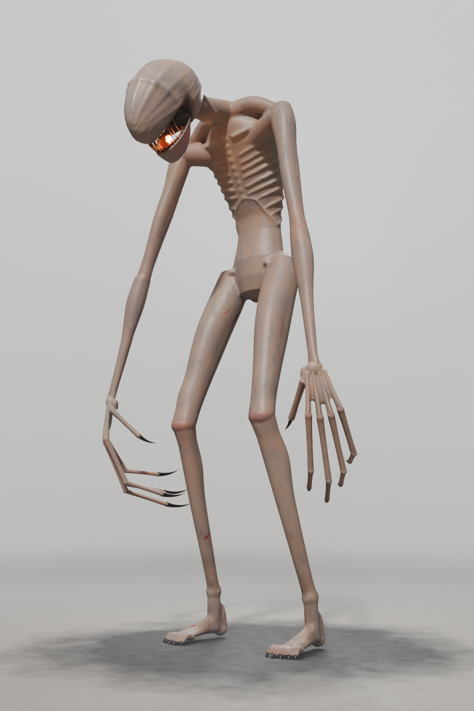

# Le monstre du jeu de survie : modèle Blender, export Roblox, rapport

Branche `monstre-blender`. Tout est fait dans Blender 5.2 (module `bpy`, sans interface) : modélisation procédurale,
textures cuites, rendus Cycles, export. La session locale fera l'import dans Roblox Studio, le montage du rig et les
tests en jeu.



## 1. Demandes et évolution

1. Tâche de départ (`monstre/TACHE_MONSTRE.md`) : le monstre de tendons noirs de `monstre/reference.webp`, fait
   dans Blender, avec les contraintes Roblox (rig rigide de 37 pièces, 20 000 triangles au plus par maillage).
   Une première version « tendons noirs » a été faite (brins torsadés, filaments qui gouttent, racines) ; elle a été
   remplacée à la demande de l'utilisateur et n'est pas livrée (son générateur reste dans `mon_body.py`).
2. Demande suivante : « fais un truc beaucoup plus réaliste avec de vraies textures ! (fais tout sur Blender) ».
   Peau, matières et éclairage réalistes, textures cuites dans Blender.
3. Puis, avec une image (créature humanoïde pâle, nue, décharnée, aux membres démesurés, dans une pièce sombre en
   bois, conservée dans `monstre/reference_style_utilisateur.png`) : « fais un truc plus dans ce style ». Le monstre
   est devenu une **créature en peau réaliste**. De la référence d'origine, on garde la posture voûtée, la tête
   basse projetée vers l'avant, lisse, allongée et sans yeux, la fente de gueule aux crocs fins avec la lueur
   orangée, les bras qui pendent jusqu'aux genoux et les longs doigts griffus. Les racines des pieds sont devenues
   de longs pieds osseux griffus ; les tendons noirs et les filaments ont disparu au profit de la peau.

## 2. Rendus (`monstre/rendus/`, Cycles, 1024 × 1536)

| Fichier | Vue |
|---|---|
| `trois_quarts.png` | trois quarts face, comme la référence, fond clair et brumeux (posture de repos, mâchoire un peu plus ouverte) |
| `face.png`, `profil.png`, `dos.png` | face, profil, dos (posture de repos) |
| `tete.png` | gros plan de la tête et de la gueule |
| `main.png` | gros plan de la main droite |
| `trois_quarts_sombre.png`, `tete_sombre.png` | dans une pièce sombre en bois, comme l'image de style de l'utilisateur (même posture) |
| `pliage.png` | contrôle : articulations franchement pliées (manchons) |

## 3. Versions et environnement

- Blender **5.2.3 LTS** en module Python (`bpy` 5.2.3), Python 3.13.17, numpy 2.5.4, scipy 1.18.1, Pillow 13.0.0.
- Rendus et cuissons : Cycles CPU (4 cœurs, pas de GPU), débruitage OpenImageDenoise, transformée de vue AgX
  (« Medium High Contrast »).
- L'environnement Python est hors du dépôt (voir `monstre/blender/scripts/README.md`).

## 4. Méthode

1. **Squelette** (`mon_skel.py`) : pivots, repère de tête et découpage du prototype (`J`, `FH`/`UH`, `rig_spec()`,
   37 pièces), agrandis d'un facteur 1,32.
2. **Anatomie** (`mon_flesh.py`, repère Roblox) : surfaces balayées à profil anatomique pour le tronc (section avec
   colonne en creux, ventre creusé sous les côtes) et les membres (quadriceps, ischio-jambiers, mollet, deltoïde,
   biceps, triceps, fléchisseurs…), et des formes simples pour ce qui affleure sous la peau d'une créature affamée :
   10 paires de côtes irrégulières, rebord costal, sternum, vertèbres saillantes, omoplates (bord interne, épine),
   clavicules, crêtes et épines iliaques, rotules, tendons rotuliens, crêtes tibiales, malléoles, tendons d'Achille,
   tendons des poignets et du dos des mains et des pieds. Tête : crâne paramétrique sans yeux (orbites creuses,
   arcades, pommettes), gueule fendue au palais rouge sombre, 26 crocs en haut, 22 en bas, mâchoire séparée. Mains :
   paume, métacarpes, articulations, doigts en 2 segments, griffes noires à pointe claire ; pieds à 5 orteils griffus.
3. **Peau continue** (`mon_blend.gn_fuse`, Geometry Nodes) : toutes les formes du corps sont converties en une grille
   SDF (voxel 0,0105 stud), fermée (dilatation puis érosion de 0,035), congés (SDF Grid Fillet), puis remaillée et
   lissée (3 passes) ; couleur régionale, type de matière et direction des fibres reportés depuis les formes. Même
   chose pour chaque main (voxel 0,007) et pour la mâchoire. Ces peaux continues (≈ 2 millions de triangles) servent
   à la cuisson.
4. **Maillages de jeu** (`construire.py`, `mon_cut.py`) : la peau continue est décimée d'un bloc, puis découpée en
   pièces. Chaque sommet est rattaché à l'os le plus proche (distance normalisée par l'épaisseur du membre) et la
   frontière entre deux pièces suit la courbe où les deux distances sont égales : les triangles qui la traversent sont
   recoupés, ce qui donne des jointures régulières (pas de zigzag le long des arêtes). Deux pièces voisines partagent
   exactement les mêmes sommets de bord, avec les normales de la peau continue (normales personnalisées) : aucun
   raccord ne se voit au repos. Une pièce trop dense (cage thoracique) est redécimée seule, son bord verrouillé
   (aucun sommet du bord déplacé). Chaque jointure a un **manchon**, porté par la pièce enfant : la peau de la pièce
   parente (et des voisines qui ne sont pas ses enfants) près de la frontière, rentrée de 0,012 stud sous la surface ;
   il suit l'enfant et comble le vide quand l'articulation plie. Griffes et crocs sont des maillages séparés dans la
   même pièce.
5. **Textures** (`cuire_textures.py`, `mon_skin.py`, `mon_tex.py`) : dépliage Smart UV Project par maillage, puis
   cuisson Cycles « sélection vers actif » depuis la peau continue : couleur (16 échantillons), rugosité, normale en
   espace tangent. Peau procédurale de la version haute définition : marbrures, rougeurs aux articulations,
   ecchymoses, veines bleutées, crasse dans les plis (occlusion), terre sur les pieds et le bas des jambes, griffures
   sombres, grain, rides et plis aux articulations ; crocs jaunis, gencives rouge sombre, griffes noires à pointe
   claire. Taille des images : 256 à 1024 px selon la surface (≈ 200 px par stud).
6. **Rendus** (`rendus.py`, `mon_scene2.py`) : brume claire (ciel clair, sol qui se fond dans la brume, brume
   volumique, soleil et contre-jour) et intérieur sombre en planches (lampe chaude, contre-jour froid). Diffusion
   sous la peau (rendu seulement) ; lueur orangée dans la gueule (sphère émissive et lampe ponctuelle, parentées à la
   tête), à l'endroit du marqueur `GLOW_MOUTH`.

## 5. Maillages

| Maillage | Pièce | Parent | Triangles | Textures (px) |
|---|---|---|---:|---:|
| `MON_Pelvis_1` | Pelvis | HumanoidRootPart | 12 922 | 512 |
| `MON_Abdomen_1` | Abdomen | Pelvis | 12 157 | 512 |
| `MON_Chest_1` | Chest | Abdomen | 18 999 | 512 |
| `MON_UpperChest_1` | UpperChest | Chest | 19 000 | 1024 |
| `MON_Neck_1` | Neck | UpperChest | 5 841 | 512 |
| `MON_Head_1` | Head | Neck | 14 937 | 1024 |
| `MON_Jaw_1` | Jaw | Head | 5 000 | 256 |
| `MON_Thigh_R_1` | Thigh_R | Pelvis | 10 340 | 1024 |
| `MON_Shin_R_1` | Shin_R | Thigh_R | 9 387 | 512 |
| `MON_Foot_R_1` | Foot_R | Shin_R | 7 010 | 512 |
| `MON_UpperArm_R_1` | UpperArm_R | UpperChest | 7 178 | 512 |
| `MON_Forearm_R_1` | Forearm_R | UpperArm_R | 5 190 | 512 |
| `MON_Hand_R_1` | Hand_R | Forearm_R | 3 653 | 256 |
| `MON_Index1_R_1` | Index1_R | Hand_R | 1 406 | 256 |
| `MON_Index2_R_1` | Index2_R | Index1_R | 1 461 | 256 |
| `MON_Middle1_R_1` | Middle1_R | Hand_R | 1 496 | 256 |
| `MON_Middle2_R_1` | Middle2_R | Middle1_R | 1 613 | 256 |
| `MON_Ring1_R_1` | Ring1_R | Hand_R | 1 433 | 256 |
| `MON_Ring2_R_1` | Ring2_R | Ring1_R | 1 516 | 256 |
| `MON_Pinky1_R_1` | Pinky1_R | Hand_R | 1 346 | 256 |
| `MON_Pinky2_R_1` | Pinky2_R | Pinky1_R | 1 325 | 256 |
| `MON_Thumb1_R_1` | Thumb1_R | Hand_R | 1 688 | 256 |
| `MON_Thigh_L_1` | Thigh_L | Pelvis | 10 171 | 1024 |
| `MON_Shin_L_1` | Shin_L | Thigh_L | 9 337 | 512 |
| `MON_Foot_L_1` | Foot_L | Shin_L | 6 946 | 512 |
| `MON_UpperArm_L_1` | UpperArm_L | UpperChest | 7 220 | 512 |
| `MON_Forearm_L_1` | Forearm_L | UpperArm_L | 5 105 | 512 |
| `MON_Hand_L_1` | Hand_L | Forearm_L | 3 636 | 256 |
| `MON_Index1_L_1` | Index1_L | Hand_L | 1 424 | 256 |
| `MON_Index2_L_1` | Index2_L | Index1_L | 1 472 | 256 |
| `MON_Middle1_L_1` | Middle1_L | Hand_L | 1 489 | 256 |
| `MON_Middle2_L_1` | Middle2_L | Middle1_L | 1 616 | 256 |
| `MON_Ring1_L_1` | Ring1_L | Hand_L | 1 433 | 256 |
| `MON_Ring2_L_1` | Ring2_L | Ring1_L | 1 523 | 256 |
| `MON_Pinky1_L_1` | Pinky1_L | Hand_L | 1 354 | 256 |
| `MON_Pinky2_L_1` | Pinky2_L | Pinky1_L | 1 314 | 256 |
| `MON_Thumb1_L_1` | Thumb1_L | Hand_L | 1 669 | 256 |

Total : **200 607 triangles** en 37 maillages (un par pièce), de 1 314 à 19 000 par maillage (limite Roblox : 20 000). Les griffes et les crocs sont comptés avec leur pièce. Chaque maillage a ses trois images : `T_<Pièce>_1_Couleur.png`, `_Rugosite.png`, `_Normale.png` (intégrées au GLB, au FBX et au .blend).

## 6. Rig

Rig rigide sur mesure, hiérarchie et pivots de `rig_spec()` (repère Roblox, studs). La racine `HumanoidRootPart` est
au pivot du bassin. Dans `Monstre.blend`, un empty `RIG_<Pièce>` par pièce, placé au pivot de son articulation et
parenté à celui de la pièce parente ; les maillages sont parentés à l'empty de leur pièce (pose de repos). Tout est
dans `monstre/export/rig.json` (parent, pivot, nom de l'articulation, maillages et triangles de chaque pièce ; boîte
englobante, hauteur, marqueurs, position de la lueur, repère de la tête et charnière de la mâchoire).

| Pièce | Parent | Articulation | Pivot (X ; Y ; Z, studs) |
|---|---|---|---|
| Pelvis | HumanoidRootPart | Root | (0,000 ; 7,128 ; 0,290) |
| Abdomen | Pelvis | SpineLow | (0,000 ; 7,854 ; 0,317) |
| Chest | Abdomen | SpineMid | (0,000 ; 8,818 ; 0,158) |
| UpperChest | Chest | SpineHigh | (0,000 ; 9,610 ; -0,290) |
| Neck | UpperChest | NeckBase | (0,000 ; 10,296 ; -0,924) |
| Head | Neck | HeadJoint | (0,000 ; 10,085 ; -1,584) |
| Jaw | Head | JawHinge | (0,000 ; 9,873 ; -1,865) |
| Thigh_R | Pelvis | Hip_R | (0,660 ; 6,864 ; 0,290) |
| Shin_R | Thigh_R | Knee_R | (0,950 ; 3,986 ; -0,818) |
| Foot_R | Shin_R | Ankle_R | (1,135 ; 0,871 ; 0,290) |
| UpperArm_R | UpperChest | Shoulder_R | (1,294 ; 9,794 ; -0,581) |
| Forearm_R | UpperArm_R | Elbow_R | (1,980 ; 7,075 ; -1,030) |
| Hand_R | Forearm_R | Wrist_R | (2,455 ; 4,567 ; -1,373) |
| Index1_R | Hand_R | Index1Joint_R | (2,398 ; 3,741 ; -1,477) |
| Index2_R | Index1_R | Index2Joint_R | (2,182 ; 2,940 ; -1,134) |
| Middle1_R | Hand_R | Middle1Joint_R | (2,542 ; 3,709 ; -1,367) |
| Middle2_R | Middle1_R | Middle2Joint_R | (2,390 ; 2,784 ; -0,940) |
| Ring1_R | Hand_R | Ring1Joint_R | (2,679 ; 3,742 ; -1,258) |
| Ring2_R | Ring1_R | Ring2Joint_R | (2,563 ; 2,936 ; -0,769) |
| Pinky1_R | Hand_R | Pinky1Joint_R | (2,794 ; 3,838 ; -1,162) |
| Pinky2_R | Pinky1_R | Pinky2Joint_R | (2,711 ; 3,214 ; -0,682) |
| Thumb1_R | Hand_R | Thumb1Joint_R | (2,281 ; 4,314 ; -1,443) |
| Thigh_L | Pelvis | Hip_L | (-0,660 ; 6,864 ; 0,290) |
| Shin_L | Thigh_L | Knee_L | (-0,950 ; 3,986 ; -0,818) |
| Foot_L | Shin_L | Ankle_L | (-1,135 ; 0,871 ; 0,290) |
| UpperArm_L | UpperChest | Shoulder_L | (-1,294 ; 9,794 ; -0,581) |
| Forearm_L | UpperArm_L | Elbow_L | (-1,980 ; 7,075 ; -1,030) |
| Hand_L | Forearm_L | Wrist_L | (-2,455 ; 4,567 ; -1,373) |
| Index1_L | Hand_L | Index1Joint_L | (-2,398 ; 3,741 ; -1,477) |
| Index2_L | Index1_L | Index2Joint_L | (-2,182 ; 2,940 ; -1,134) |
| Middle1_L | Hand_L | Middle1Joint_L | (-2,542 ; 3,709 ; -1,367) |
| Middle2_L | Middle1_L | Middle2Joint_L | (-2,390 ; 2,784 ; -0,940) |
| Ring1_L | Hand_L | Ring1Joint_L | (-2,679 ; 3,742 ; -1,258) |
| Ring2_L | Ring1_L | Ring2Joint_L | (-2,563 ; 2,936 ; -0,769) |
| Pinky1_L | Hand_L | Pinky1Joint_L | (-2,794 ; 3,838 ; -1,162) |
| Pinky2_L | Pinky1_L | Pinky2Joint_L | (-2,711 ; 3,214 ; -0,682) |
| Thumb1_L | Hand_L | Thumb1Joint_L | (-2,281 ; 4,314 ; -1,443) |

## 7. Repère, échelle et marqueurs

- 1 unité Blender = 1 stud. Repère Roblox : Y vers le haut, le monstre regarde vers −Z, sa droite est +X. Dans
  Blender : (x, y, z) Blender = (X, −Z, Y) Roblox (le monstre regarde vers +Y, Z vers le haut). Le GLB (Y en haut)
  et le FBX (axes « −Z avant, Y haut ») redonnent directement le repère Roblox.
- Marqueurs (cubes de 0,05 stud, nommés exactement) aux positions Roblox (X ; Y ; Z) : `REF_A` (0 ; 5 ; 0),
  `REF_B` (0 ; 7 ; 0), `REF_C` (1,5 ; 5 ; 0), `REF_D` (0 ; 5 ; −1), et `GLOW_MOUTH` (0,000 ; 9,024 ; -2,315) (au fond de la gueule,
  là où mettre la lueur, par exemple une petite part Neon orange et une PointLight, à souder à la tête).
- Hauteur du monstre dans sa posture voûtée : 10,61 studs (du sol au sommet du dos) ; la plante des pieds est
  vers Y = 0, les griffes des orteils descendent jusqu'à Y = -0,14.

## 8. Export

| Fichier | Contenu | Réglages |
|---|---|---|
| `export/Monstre.glb` | 37 maillages `MON_*` + 5 marqueurs, textures intégrées (couleur, normale, rugosité par maillage) | glTF binaire, Y en haut, modificateurs appliqués, normales (personnalisées) et UV, matières exportées, images PNG intégrées, pas de couleurs de sommets |
| `export/Monstre.fbx` | les mêmes maillages et marqueurs, textures intégrées | échelle 1, `FBX_SCALE_NONE`, axes −Z avant / Y haut, normales seules (pas de groupes de lissage), textures copiées et intégrées |
| `export/Monstre_couleurs_sommets.glb` | repli sans textures : couleurs des textures cuites dans les couleurs de sommets | glTF binaire, couleurs de sommets actives |
| `export/rig.json` | rig, maillages, marqueurs | voir § 6 |
| `blender/Monstre.blend` | scène complète compressée : maillages, matières à textures (images empaquetées), rig d'empties, marqueurs, scène de rendu prête (brume, lueur de la gueule, caméra trois quarts, Cycles) | la version haute définition de cuisson n'y est pas (elle se régénère) |

À l'import dans Studio (*Importer 3D*), les maillages texturés deviennent des MeshParts avec SurfaceAppearance.
Chaque maillage reste sous 20 000 triangles ; un script de montage peut retrouver échelle et orientation avec les
marqueurs, créer les Motor6D depuis `rig.json` et poser la lueur sur `GLOW_MOUTH`.

Vérification (`verifier_export.py`, réimport dans une scène Blender vide) :

```
Monstre.glb : 37 maillages MON_, 200607 triangles (max 19000), 37 matières, 111 images, hauteur 10.61 studs
  OK : noms, limite de triangles, marqueurs, normales
Monstre.fbx : 37 maillages MON_, 200607 triangles (max 19000), 37 matières, 111 images, hauteur 10.61 studs
  OK : noms, limite de triangles, marqueurs, normales
Monstre_couleurs_sommets.glb : 37 maillages MON_, 200607 triangles (max 19000), 1 matières, 0 images, hauteur 10.61 studs
  OK : noms, limite de triangles, marqueurs, normales
VERIF OK
```

Tailles : `Monstre.glb` 20,3 Mo, `Monstre.fbx` 21,9 Mo, `Monstre_couleurs_sommets.glb` 7,5 Mo, `Monstre.blend` 24,1 Mo. Boîte englobante (Roblox) : X de -2,85 à 2,85, Y de -0,14 à 10,61, Z de -3,34 à 0,79.

## 9. Comparaison avec les références

- **Image de style de l'utilisateur** : peau pâle et réaliste, créature nue, très maigre, membres démesurés, os qui
  affleurent ; même ambiance sombre (rendu `trois_quarts_sombre`). Le visage de l'image étant masqué, la tête vient
  de la référence d'origine.
- **Référence d'origine** : même silhouette (grand, voûté, dos rond, tête basse projetée vers l'avant, genoux un peu
  fléchis, bras jusqu'aux genoux, longs doigts griffus), tête lisse allongée sans yeux, fente de gueule aux crocs fins
  avec lueur orangée, fond clair et brumeux. Ce qui a changé à la demande de l'utilisateur : la matière (peau au lieu
  de tendons noirs mouillés), plus de filaments ni de trous, pieds griffus au lieu de racines.

## 10. Limites connues

- **Rig rigide** : chaque pièce bouge en bloc. Les manchons comblent les trous quand une articulation plie, mais un
  pli franc montre la jointure comme un anneau net (voir `pliage.png`), surtout aux hanches, aux genoux et à la
  taille ; une rotation du cou ou de la tête de plus de quelques degrés laisse voir une fine fente sombre à la
  jointure (le rendu de présentation est donc en posture de repos, seule la mâchoire s'ouvre un peu). Les manchons
  sont plus courts sur la cage thoracique (limite de triangles) : le tronc doit garder de petites rotations.
- Raccords invisibles au repos dans Blender ; dans Roblox, ils dépendent du respect des normales importées et du
  filtrage des textures au bord des îlots UV (un fin liseré reste possible de près).
- **Textures par maillage** (37 jeux de 3 images, 256 à 1024 px) : environ 18 Mo d'images ; la diffusion sous la peau,
  la brume et la lueur n'existent que dans les rendus Blender.
- Total 200 607 triangles : dans la cible (150 000 à 300 000), mais lourd pour un PNJ ; une version plus légère se
  fait en baissant les budgets de `construire.py` (la cuisson garde le détail dans les normales).
- Taille : environ 10,61 studs de haut ; `Model:ScaleTo()` dans Studio pour l'ajuster.
- Jamais importé dans un vrai Roblox Studio depuis cette session : la vérification a été faite en réimportant le GLB
  et le FBX dans Blender.

## 11. Régénérer

Voir `monstre/blender/scripts/README.md` : `construire.py` (≈ 4 min), `cuire_textures.py` (≈ 8 min), `rendus.py`
(≈ 5 min par vue en 1024 px), `exporter.py`, `verifier_export.py`.
