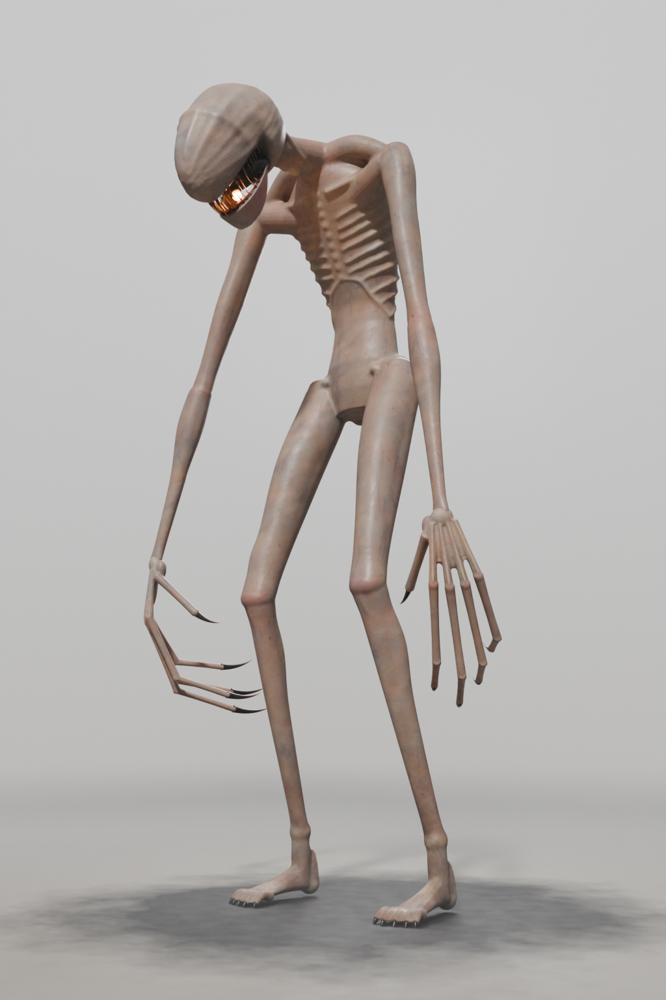
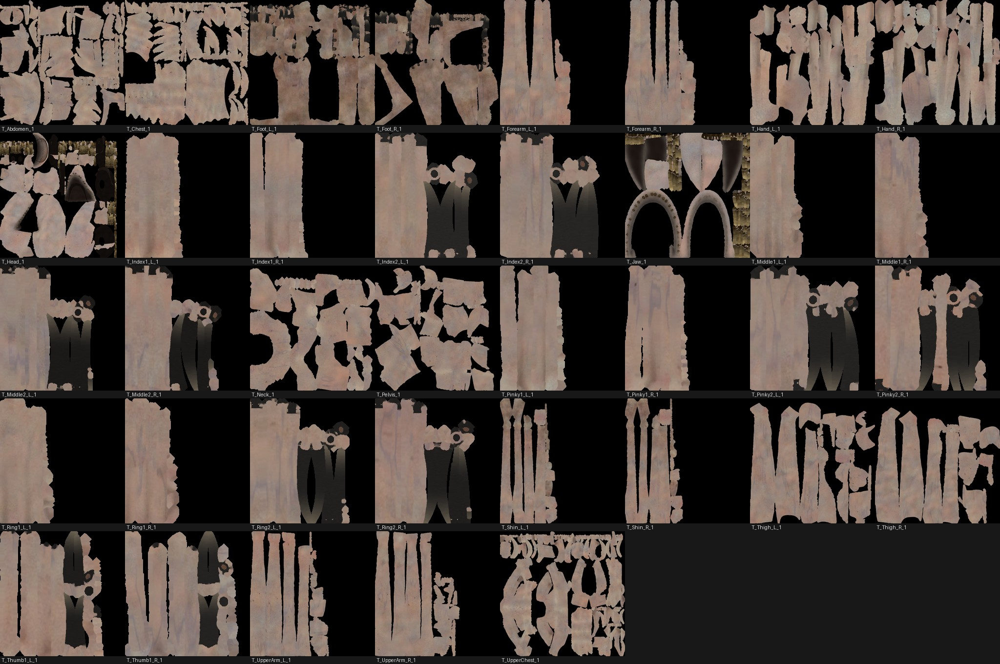
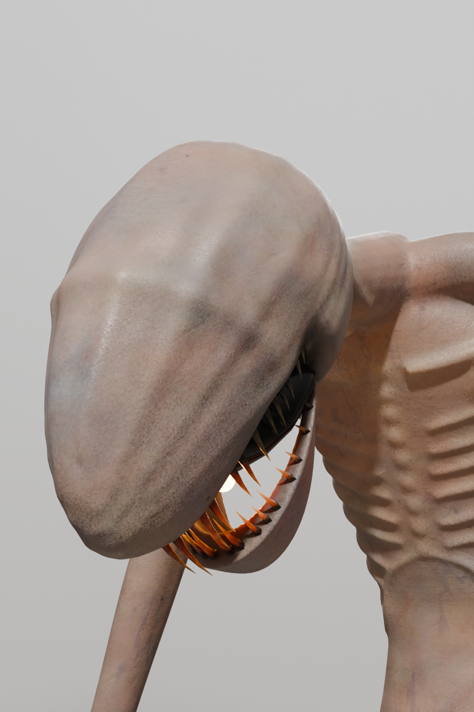
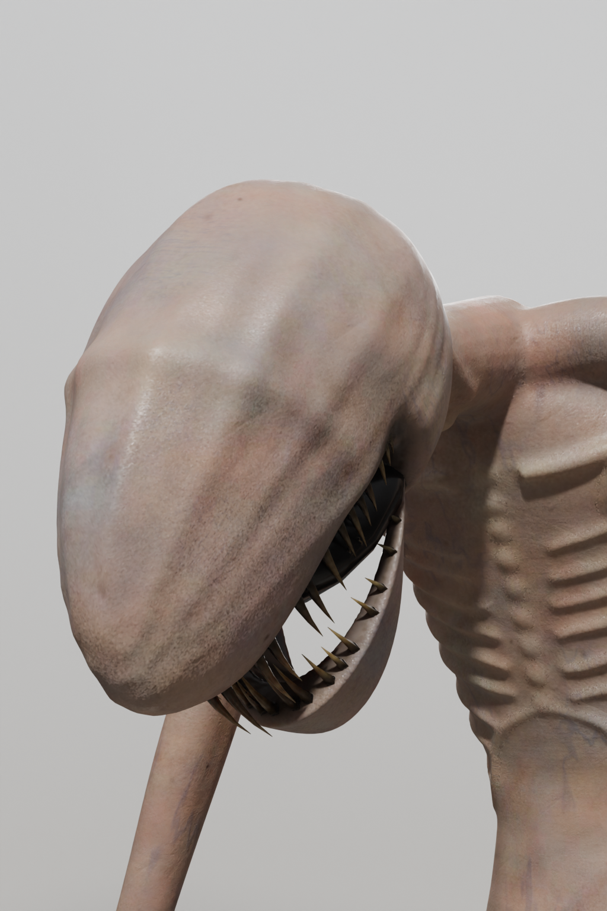
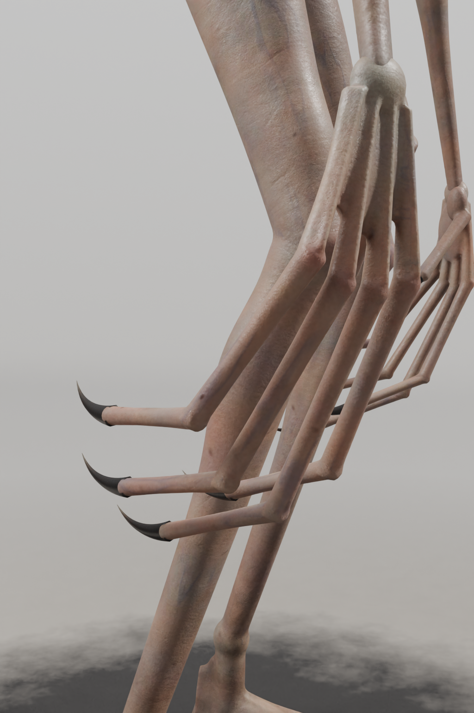

# Le monstre sans sang : textures recuites pour Roblox

Branche `monstre-sans-sang`, partie de `monstre-blender` (commit `4aeed98`). Tâche : `monstre/TACHE_SANS_SANG.md`
(sur `main`).

Le 24/10/2026, l'import 3D de `monstre/export/Monstre.fbx` dans Roblox Studio a été **refusé par la modération de
Roblox**, qui a aussi **averti le compte** de l'utilisateur : la texture `MAT_Ring1_L_1` (peau tachée de sang) a été
jugée contraire aux règles (« Roblox does not permit violent content and gore, including excessive use of blood in
images or videos »). Tout ce qui est importé est téléversé sur le compte et modéré. Cette version garde le même modèle
et la même peau réaliste, mais **aucune image ne contient de sang ni rien qui ressemble à une plaie**, et l'export
n'a plus les 7 gabarits de sang `SANG_*`.



## 1. En bref

- Les 37 textures de couleur ont été recuites avec `SANG=non` : **0 pixel rouge sang dans chacune** (critère :
  R > 0,3, R > 2 G et R > 2 B en sRGB), dans `Monstre.glb` comme dans `Monstre.fbx`. Avant : 4 749 057 pixels rouge
  sang (gabarits compris), dont 0,83 % de la texture refusée `T_Ring1_L_1_Couleur` et jusqu'à 17 % des phalanges.
- Plus aucun gabarit `SANG_*` (7 avant) : 111 images intégrées par fichier au lieu de 132.
- Même modèle : `rig.json` identique octet pour octet ; mêmes 37 maillages `MON_*`, mêmes positions de sommets, mêmes
  UV et mêmes triangles (200 607) que l'export refusé (écart nul) ; mêmes marqueurs `REF_A` à `REF_D` et `GLOW_MOUTH` ;
  `verifier_export.py` : `VERIF OK`.
- Rendus de contrôle Cycles regardés un à un, ainsi que chacune des 37 textures de couleur : ni sang, ni plaie, ni
  griffure, ni ecchymose ; gueule brun-noir, crocs ivoire jauni, griffes gris anthracite à pointe ivoire.
- Le repli `Monstre_couleurs_sommets.glb`, que l'exporteur refait toujours depuis les textures, contenait lui aussi du
  sang (708 sommets rouge sang sur 129 789) : il n'en a plus (0).
- Non modifiés : animations, `monstre/roblox/`, `src/`, `roblox/`, `dist/`.

## 2. Ce qui a changé

### 2.1 Matière de la peau (`blender/scripts/mon_skin.py`)

| Couche | Avant | Maintenant |
|---|---|---|
| Sang : frais, séché, croûtes, coulures, éclaboussures (`mon_sang.py`) | cuit (`SANG` valait `oui` par défaut) | **non cuit** (`SANG=non`, désormais la valeur par défaut) |
| Griffures rouge sombre : bandes ondulées fines, couleur (0,28 ; 0,04 ; 0,03) et sillon dans le relief | oui | **retirées** (couleur et relief) |
| Ecchymoses violacées à bord jaunâtre | oui | **retirées** |
| Rougeurs aux articulations | 0,9 × teinte (1,05 ; 0,66 ; 0,62) | **0,45 × teinte (1,03 ; 0,87 ; 0,83)** : très discrètes, rosées |
| Crasse dans les plis (occlusion) | × (0,30 ; 0,20 ; 0,17), brun-rouge | **× (0,33 ; 0,26 ; 0,22), gris-brun** |
| Vraies textures de peau (grain, pores, ridules, brillance), marbrures, petites taches, veines bleutées, crasse par plaques, terre sur les pieds, rides et plis | | inchangées |

La crasse des plis a été ajustée après la cuisson d'essai : là où l'occlusion est totale (capuchon de la racine des
griffes, caché dans le bout des doigts, creux entre les orteils), elle donnait un brun cuivré (0,35 ; 0,24 ; 0,20),
la teinte la plus proche d'un sang séché. Elle reste là, en gris-brun.

### 2.2 Gueule et griffes (`blender/scripts/mon_flesh.py`, `mon_gen.py`)

Ces couleurs régionales (attribut `Col` de la peau haute définition) sont posées par `construire.py`. Elles ne
touchent pas la forme : la construction redonne exactement les mêmes maillages.

- **Gencives, palais, gorge, intérieur de la mâchoire et dégradé des lèvres** : `GUMC` passe de (0,36 ; 0,08 ; 0,07),
  rouge sombre, à **(0,12 ; 0,09 ; 0,075), brun-noir** (la gorge en prend 0,6 ×). Avant, ces gencives sortaient en
  rouge sang au critère même sans le sang (export d'avant l'ajout du sang, commit `45fba17` : 3,57 % de la texture de
  la tête, 8,98 % de celle de la mâchoire), et les lèvres formaient un liseré rouge. La lueur orangée reste à ajouter
  dans Roblox (l'installateur pose une boule Neon et une PointLight sur `GLOW_MOUTH`).
- **Griffes des mains et des pieds** : base presque noire (0,06 ; 0,055 ; 0,052) → **gris anthracite
  (0,13 ; 0,125 ; 0,12)**, pointe ivoire sale (0,42 ; 0,38 ; 0,32) inchangée. `mon_gen.claw` reçoit ces couleurs
  (paramètres `col` et `tip`, constantes `NAIL` et `NAIL_TIP`, définies mais inutilisées jusque-là) ; sans elles, il
  garde les anciennes (générateur « tendons » de `mon_body.py`).
- **Crocs** : ivoire jauni à taches brunes (`BONE`), inchangés. La fonction `fang` n'est pas modifiée : elle partage
  son tirage aléatoire avec la forme des crocs.

### 2.3 Chaîne de scripts (`blender/scripts/`)

| Script | Changement |
|---|---|
| `cuire_textures.py` | `SANG` vaut `non` par défaut ; `SANG=oui` seulement pour des rendus hors jeu |
| `exporter.py` | appelé **sans** le 3e argument : aucun gabarit `SANG_*` (docstring précisée) |
| `verifier_export.py` | par défaut, **aucun** gabarit `SANG_*` n'est admis (option `sang` pour l'ancienne version) ; nombre de gabarits affiché |
| `controle_sang.py` (nouveau) | sans Blender : lit `Monstre.glb` et `Monstre.fbx`, extrait toutes les images intégrées, compte les pixels rouge sang et rougeâtres de chacune, signale les gabarits `SANG_*`, liste les images (`--md`), planche des textures de couleur (`--planche`) ; code de sortie 1 s'il trouve du sang |
| `rendus.py` | vue `tete_sans_lueur` : la tête sans la lumière orange, pour juger la vraie couleur de la gueule |
| `README.md` | chaîne sans sang, avertissement sur la version avec sang |

Hors des scripts : une note pour la session locale en tête de `monstre/CLAUDE.md`, et un renvoi vers ce rapport en
tête de `RAPPORT_MONSTRE.md`. `mon_sang.py` et `sang_decals.py` restent dans le dépôt (version avec sang, hors jeu).

## 3. Commandes et durées

Machine : 4 cœurs, 15 Go de mémoire, Cycles CPU. Blender **5.2.3 LTS** en module (`bpy` 5.2.3), Python 3.13.17,
numpy 2.5.4, scipy 1.18.1, Pillow 13.0.0. Les fichiers intermédiaires (`creature.blend`, `creature_tex.blend`,
`textures/`) restent hors du dépôt, comme avant.

```bash
uv venv -p 3.13 venv && uv pip install --python venv/bin/python "bpy==5.2.*" numpy scipy pillow   # 32 s
PY=$PWD/venv/bin/python
cd monstre/blender/scripts
$PY construire.py -- creature.blend                                    # 3 min 28 s (37 maillages, 200 607 triangles)
SANG=non BSPP=8 $PY cuire_textures.py -- creature.blend creature_test.blend tex_test \
    Head,Jaw,Hand_L,Ring1_L,Ring2_L,Index2_R,Foot_R                     # essai sur 7 maillages : 1 min 21 s
SANG=non BSPP=16 $PY cuire_textures.py -- creature.blend creature_tex.blend textures   # 10 min 27 s (cuisson : 625 s)
$PY exporter.py -- creature_tex.blend ../..                            # 1 min 12 s, sans 3e argument
$PY verifier_export.py -- ../..                                        # 5 s : VERIF OK
$PY -I controle_sang.py ../../export --md controle.md --planche ../../rendus/sans_sang/textures_couleur.jpg   # 5 s : SANG ABSENT
$PY rendus.py -- creature_tex.blend ../../rendus/sans_sang trois_quarts,tete,tete_sans_lueur,main 1024 96   # 13 min 2 s
```

Total : environ 30 minutes de calcul (rendus : trois quarts 2 min 42 s, tête 3 min 44 s, tête sans lueur 3 min 6 s,
main 3 min 30 s). Entre la cuisson d'essai et la cuisson complète, seule la crasse des plis a changé (§ 2.1).

## 4. Contrôle des pixels rouges (`controle_sang.py`)

Chaque image est lue telle qu'elle est intégrée aux fichiers exportés (pas les PNG du disque) : le GLB et le FBX sont
décodés directement, puis chaque image est analysée en sRGB (valeurs du fichier). Deux critères :

- **rouge sang** (celui de la tâche) : R > 0,3, R > 2 G et R > 2 B ;
- **rougeâtre** (plus large, pour la marge) : R > 0,2, R > 1,5 G et R > 1,5 B. Il attrape le sang séché sombre, que le
  premier laisse passer (dans l'export refusé, `T_Foot_L_1_Couleur` avait 0,00 % de rouge sang mais 29 % de pixels
  rougeâtres : les pieds avaient « marché dans le sang »).

Avant = l'export refusé (branche `monstre-blender`) ; après = cet export. Les valeurs sont les mêmes dans le GLB et le
FBX, qui intègrent les mêmes images (§ 5).

| Texture de couleur | Taille | Avant (export refusé) : rouge sang | Avant : rougeâtre | Après (GLB et FBX) : rouge sang | Après : rougeâtre |
|---|---:|---:|---:|---:|---:|
| `SANG_Eclaboussure_1_Couleur` (gabarit) | 1024 px | 92,38 % | 97,70 % | retiré | retiré |
| `SANG_Eclaboussure_2_Couleur` (gabarit) | 1024 px | 88,98 % | 96,52 % | retiré | retiré |
| `SANG_Eclaboussure_3_Couleur` (gabarit) | 1024 px | 86,85 % | 95,69 % | retiré | retiré |
| `SANG_Ecran_Couleur` (gabarit) | 1024 px | 84,67 % | 93,47 % | retiré | retiré |
| `SANG_Flaque_Couleur` (gabarit) | 1024 px | 68,03 % | 69,39 % | retiré | retiré |
| `SANG_Goutte_Couleur` (gabarit) | 128 px | 62,95 % | 95,39 % | retiré | retiré |
| `SANG_Trainee_Couleur` (gabarit) | 1024 px | 48,05 % | 95,32 % | retiré | retiré |
| `T_Abdomen_1_Couleur` | 1024 px | 0,00 % | 0,02 % | **0 px (0,0000 %)** | 0,000 % |
| `T_Chest_1_Couleur` | 1024 px | 0,00 % | 0,03 % | **0 px (0,0000 %)** | 0,000 % |
| `T_Foot_L_1_Couleur` | 512 px | 0,00 % | 29,08 % | **0 px (0,0000 %)** | 0,036 % |
| `T_Foot_R_1_Couleur` | 512 px | 0,57 % | 25,64 % | **0 px (0,0000 %)** | 0,000 % |
| `T_Forearm_L_1_Couleur` | 512 px | 0,12 % | 2,77 % | **0 px (0,0000 %)** | 0,000 % |
| `T_Forearm_R_1_Couleur` | 512 px | 0,26 % | 3,78 % | **0 px (0,0000 %)** | 0,000 % |
| `T_Hand_L_1_Couleur` | 512 px | 2,49 % | 5,90 % | **0 px (0,0000 %)** | 0,000 % |
| `T_Hand_R_1_Couleur` | 512 px | 1,59 % | 3,78 % | **0 px (0,0000 %)** | 0,000 % |
| `T_Head_1_Couleur` | 1024 px | 5,16 % | 31,78 % | **0 px (0,0000 %)** | 0,004 % |
| `T_Index1_L_1_Couleur` | 256 px | 1,53 % | 3,79 % | **0 px (0,0000 %)** | 0,000 % |
| `T_Index1_R_1_Couleur` | 256 px | 2,22 % | 5,56 % | **0 px (0,0000 %)** | 0,000 % |
| `T_Index2_L_1_Couleur` | 256 px | 13,96 % | 45,29 % | **0 px (0,0000 %)** | 0,000 % |
| `T_Index2_R_1_Couleur` | 256 px | 13,49 % | 45,26 % | **0 px (0,0000 %)** | 0,000 % |
| `T_Jaw_1_Couleur` | 512 px | 12,94 % | 64,25 % | **0 px (0,0000 %)** | 0,000 % |
| `T_Middle1_L_1_Couleur` | 256 px | 1,29 % | 3,27 % | **0 px (0,0000 %)** | 0,000 % |
| `T_Middle1_R_1_Couleur` | 256 px | 0,32 % | 0,94 % | **0 px (0,0000 %)** | 0,000 % |
| `T_Middle2_L_1_Couleur` | 256 px | 12,90 % | 39,18 % | **0 px (0,0000 %)** | 0,000 % |
| `T_Middle2_R_1_Couleur` | 256 px | 14,02 % | 41,88 % | **0 px (0,0000 %)** | 0,000 % |
| `T_Neck_1_Couleur` | 512 px | 0,08 % | 2,87 % | **0 px (0,0000 %)** | 0,000 % |
| `T_Pelvis_1_Couleur` | 1024 px | 0,00 % | 0,06 % | **0 px (0,0000 %)** | 0,000 % |
| `T_Pinky1_L_1_Couleur` | 256 px | 1,75 % | 4,33 % | **0 px (0,0000 %)** | 0,000 % |
| `T_Pinky1_R_1_Couleur` | 256 px | 0,72 % | 1,83 % | **0 px (0,0000 %)** | 0,000 % |
| `T_Pinky2_L_1_Couleur` | 256 px | 17,07 % | 55,50 % | **0 px (0,0000 %)** | 0,000 % |
| `T_Pinky2_R_1_Couleur` | 256 px | 16,08 % | 53,63 % | **0 px (0,0000 %)** | 0,009 % |
| `T_Ring1_L_1_Couleur` (texture refusée) | 256 px | 0,83 % | 2,14 % | **0 px (0,0000 %)** | 0,000 % |
| `T_Ring1_R_1_Couleur` | 256 px | 1,39 % | 3,62 % | **0 px (0,0000 %)** | 0,000 % |
| `T_Ring2_L_1_Couleur` | 256 px | 14,78 % | 43,60 % | **0 px (0,0000 %)** | 0,000 % |
| `T_Ring2_R_1_Couleur` | 256 px | 13,91 % | 43,81 % | **0 px (0,0000 %)** | 0,000 % |
| `T_Shin_L_1_Couleur` | 1024 px | 0,00 % | 1,12 % | **0 px (0,0000 %)** | 0,000 % |
| `T_Shin_R_1_Couleur` | 1024 px | 0,02 % | 1,43 % | **0 px (0,0000 %)** | 0,000 % |
| `T_Thigh_L_1_Couleur` | 1024 px | 0,00 % | 0,15 % | **0 px (0,0000 %)** | 0,000 % |
| `T_Thigh_R_1_Couleur` | 1024 px | 0,01 % | 0,39 % | **0 px (0,0000 %)** | 0,000 % |
| `T_Thumb1_L_1_Couleur` | 256 px | 11,01 % | 44,16 % | **0 px (0,0000 %)** | 0,000 % |
| `T_Thumb1_R_1_Couleur` | 256 px | 11,30 % | 47,08 % | **0 px (0,0000 %)** | 0,000 % |
| `T_UpperArm_L_1_Couleur` | 1024 px | 0,00 % | 0,22 % | **0 px (0,0000 %)** | 0,000 % |
| `T_UpperArm_R_1_Couleur` | 1024 px | 0,00 % | 0,48 % | **0 px (0,0000 %)** | 0,000 % |
| `T_UpperChest_1_Couleur` | 1024 px | 0,01 % | 0,39 % | **0 px (0,0000 %)** | 0,000 % |

Total des pixels rouge sang dans les textures de couleur : 4 749 057 avant (gabarits compris), **0** après.

Autres images :

- **Normales** (37 par fichier) : quelques pixels passent le critère sur les îlots des crocs et des racines de
  griffes (`T_Jaw_1_Normale` 0,4337 %, `T_Head_1_Normale` 0,0539 %, `T_Foot_R_1_Normale` 0,0015 %,
  `T_Foot_L_1_Normale` 0,0008 %). Ce sont des pointes magenta (0,63 ; 0,15 ; 0,22) dans une image bleu-violet, les
  artefacts habituels d'une carte de normales sur des aiguilles très fines, présents à l'identique dans l'export refusé
  (`T_Jaw_1_Normale` : 0,4337 % avant comme après) ; rien qui ressemble à du sang.
- **Rugosité** (37 par fichier) : niveaux de gris dans le FBX ; dans le GLB, l'exporteur glTF range la rugosité dans
  le canal vert d'une image « metallicRoughness » dont le rouge et le bleu valent 1 (magenta clair) : 0 pixel rouge
  sang dans les deux.
- **Repli** `Monstre_couleurs_sommets.glb` (couleurs de sommets, sans image) : 0 sommet rouge sang ni rougeâtre sur
  129 789 (avant : 708 sommets rouge sang, 1 713 rougeâtres).
- **Rendus** (pour mémoire) : 0 % de rouge sang dans `tete_sans_lueur.png` et `main.png`. Dans les vues avec la
  lueur, la lumière orange saturée sur les crocs passe le critère (`tete.png` 0,43 %, `trois_quarts.png` 0,02 %) :
  c'est l'éclairage du rendu, pas les textures.

Planche de toutes les textures de couleur exportées, telles que la modération les reçoit (`--planche` : les pixels
rouge sang y seraient entourés de magenta ; il n'y en a aucun) :



## 5. Images intégrées aux exports

`Monstre.glb` et `Monstre.fbx` intègrent chacun **111 images** : 3 par maillage (couleur, normale, rugosité), aucune
autre (export refusé : 132, dont 21 pour les 7 gabarits de sang). Les noms sont les mêmes dans les deux fichiers ; les
37 images de couleur et les 37 normales sont identiques octet pour octet dans le GLB, le FBX et les PNG cuits ; seules
les rugosités diffèrent dans le GLB (rangées dans le canal vert par l'exporteur glTF). Le `.blend` empaquette les
mêmes 111 images, sans gabarit, sans attribut de sang (0 pixel rouge sang dans ses images de couleur).

| Maillage | Matière | Taille | Images intégrées (GLB et FBX) |
|---|---|---:|---|
| `MON_Abdomen_1` | `MAT_Abdomen_1` | 1024 px | `T_Abdomen_1_Couleur.png`, `T_Abdomen_1_Normale.png`, `T_Abdomen_1_Rugosite.png` |
| `MON_Chest_1` | `MAT_Chest_1` | 1024 px | `T_Chest_1_Couleur.png`, `T_Chest_1_Normale.png`, `T_Chest_1_Rugosite.png` |
| `MON_Foot_L_1` | `MAT_Foot_L_1` | 512 px | `T_Foot_L_1_Couleur.png`, `T_Foot_L_1_Normale.png`, `T_Foot_L_1_Rugosite.png` |
| `MON_Foot_R_1` | `MAT_Foot_R_1` | 512 px | `T_Foot_R_1_Couleur.png`, `T_Foot_R_1_Normale.png`, `T_Foot_R_1_Rugosite.png` |
| `MON_Forearm_L_1` | `MAT_Forearm_L_1` | 512 px | `T_Forearm_L_1_Couleur.png`, `T_Forearm_L_1_Normale.png`, `T_Forearm_L_1_Rugosite.png` |
| `MON_Forearm_R_1` | `MAT_Forearm_R_1` | 512 px | `T_Forearm_R_1_Couleur.png`, `T_Forearm_R_1_Normale.png`, `T_Forearm_R_1_Rugosite.png` |
| `MON_Hand_L_1` | `MAT_Hand_L_1` | 512 px | `T_Hand_L_1_Couleur.png`, `T_Hand_L_1_Normale.png`, `T_Hand_L_1_Rugosite.png` |
| `MON_Hand_R_1` | `MAT_Hand_R_1` | 512 px | `T_Hand_R_1_Couleur.png`, `T_Hand_R_1_Normale.png`, `T_Hand_R_1_Rugosite.png` |
| `MON_Head_1` | `MAT_Head_1` | 1024 px | `T_Head_1_Couleur.png`, `T_Head_1_Normale.png`, `T_Head_1_Rugosite.png` |
| `MON_Index1_L_1` | `MAT_Index1_L_1` | 256 px | `T_Index1_L_1_Couleur.png`, `T_Index1_L_1_Normale.png`, `T_Index1_L_1_Rugosite.png` |
| `MON_Index1_R_1` | `MAT_Index1_R_1` | 256 px | `T_Index1_R_1_Couleur.png`, `T_Index1_R_1_Normale.png`, `T_Index1_R_1_Rugosite.png` |
| `MON_Index2_L_1` | `MAT_Index2_L_1` | 256 px | `T_Index2_L_1_Couleur.png`, `T_Index2_L_1_Normale.png`, `T_Index2_L_1_Rugosite.png` |
| `MON_Index2_R_1` | `MAT_Index2_R_1` | 256 px | `T_Index2_R_1_Couleur.png`, `T_Index2_R_1_Normale.png`, `T_Index2_R_1_Rugosite.png` |
| `MON_Jaw_1` | `MAT_Jaw_1` | 512 px | `T_Jaw_1_Couleur.png`, `T_Jaw_1_Normale.png`, `T_Jaw_1_Rugosite.png` |
| `MON_Middle1_L_1` | `MAT_Middle1_L_1` | 256 px | `T_Middle1_L_1_Couleur.png`, `T_Middle1_L_1_Normale.png`, `T_Middle1_L_1_Rugosite.png` |
| `MON_Middle1_R_1` | `MAT_Middle1_R_1` | 256 px | `T_Middle1_R_1_Couleur.png`, `T_Middle1_R_1_Normale.png`, `T_Middle1_R_1_Rugosite.png` |
| `MON_Middle2_L_1` | `MAT_Middle2_L_1` | 256 px | `T_Middle2_L_1_Couleur.png`, `T_Middle2_L_1_Normale.png`, `T_Middle2_L_1_Rugosite.png` |
| `MON_Middle2_R_1` | `MAT_Middle2_R_1` | 256 px | `T_Middle2_R_1_Couleur.png`, `T_Middle2_R_1_Normale.png`, `T_Middle2_R_1_Rugosite.png` |
| `MON_Neck_1` | `MAT_Neck_1` | 512 px | `T_Neck_1_Couleur.png`, `T_Neck_1_Normale.png`, `T_Neck_1_Rugosite.png` |
| `MON_Pelvis_1` | `MAT_Pelvis_1` | 1024 px | `T_Pelvis_1_Couleur.png`, `T_Pelvis_1_Normale.png`, `T_Pelvis_1_Rugosite.png` |
| `MON_Pinky1_L_1` | `MAT_Pinky1_L_1` | 256 px | `T_Pinky1_L_1_Couleur.png`, `T_Pinky1_L_1_Normale.png`, `T_Pinky1_L_1_Rugosite.png` |
| `MON_Pinky1_R_1` | `MAT_Pinky1_R_1` | 256 px | `T_Pinky1_R_1_Couleur.png`, `T_Pinky1_R_1_Normale.png`, `T_Pinky1_R_1_Rugosite.png` |
| `MON_Pinky2_L_1` | `MAT_Pinky2_L_1` | 256 px | `T_Pinky2_L_1_Couleur.png`, `T_Pinky2_L_1_Normale.png`, `T_Pinky2_L_1_Rugosite.png` |
| `MON_Pinky2_R_1` | `MAT_Pinky2_R_1` | 256 px | `T_Pinky2_R_1_Couleur.png`, `T_Pinky2_R_1_Normale.png`, `T_Pinky2_R_1_Rugosite.png` |
| `MON_Ring1_L_1` | `MAT_Ring1_L_1` | 256 px | `T_Ring1_L_1_Couleur.png`, `T_Ring1_L_1_Normale.png`, `T_Ring1_L_1_Rugosite.png` |
| `MON_Ring1_R_1` | `MAT_Ring1_R_1` | 256 px | `T_Ring1_R_1_Couleur.png`, `T_Ring1_R_1_Normale.png`, `T_Ring1_R_1_Rugosite.png` |
| `MON_Ring2_L_1` | `MAT_Ring2_L_1` | 256 px | `T_Ring2_L_1_Couleur.png`, `T_Ring2_L_1_Normale.png`, `T_Ring2_L_1_Rugosite.png` |
| `MON_Ring2_R_1` | `MAT_Ring2_R_1` | 256 px | `T_Ring2_R_1_Couleur.png`, `T_Ring2_R_1_Normale.png`, `T_Ring2_R_1_Rugosite.png` |
| `MON_Shin_L_1` | `MAT_Shin_L_1` | 1024 px | `T_Shin_L_1_Couleur.png`, `T_Shin_L_1_Normale.png`, `T_Shin_L_1_Rugosite.png` |
| `MON_Shin_R_1` | `MAT_Shin_R_1` | 1024 px | `T_Shin_R_1_Couleur.png`, `T_Shin_R_1_Normale.png`, `T_Shin_R_1_Rugosite.png` |
| `MON_Thigh_L_1` | `MAT_Thigh_L_1` | 1024 px | `T_Thigh_L_1_Couleur.png`, `T_Thigh_L_1_Normale.png`, `T_Thigh_L_1_Rugosite.png` |
| `MON_Thigh_R_1` | `MAT_Thigh_R_1` | 1024 px | `T_Thigh_R_1_Couleur.png`, `T_Thigh_R_1_Normale.png`, `T_Thigh_R_1_Rugosite.png` |
| `MON_Thumb1_L_1` | `MAT_Thumb1_L_1` | 256 px | `T_Thumb1_L_1_Couleur.png`, `T_Thumb1_L_1_Normale.png`, `T_Thumb1_L_1_Rugosite.png` |
| `MON_Thumb1_R_1` | `MAT_Thumb1_R_1` | 256 px | `T_Thumb1_R_1_Couleur.png`, `T_Thumb1_R_1_Normale.png`, `T_Thumb1_R_1_Rugosite.png` |
| `MON_UpperArm_L_1` | `MAT_UpperArm_L_1` | 1024 px | `T_UpperArm_L_1_Couleur.png`, `T_UpperArm_L_1_Normale.png`, `T_UpperArm_L_1_Rugosite.png` |
| `MON_UpperArm_R_1` | `MAT_UpperArm_R_1` | 1024 px | `T_UpperArm_R_1_Couleur.png`, `T_UpperArm_R_1_Normale.png`, `T_UpperArm_R_1_Rugosite.png` |
| `MON_UpperChest_1` | `MAT_UpperChest_1` | 1024 px | `T_UpperChest_1_Couleur.png`, `T_UpperChest_1_Normale.png`, `T_UpperChest_1_Rugosite.png` |

## 6. Rendus de contrôle (`rendus/sans_sang/`, Cycles, 1024 × 1536, 96 échantillons)

Mêmes scènes, caméras et réglages qu'avant (`rendus.py`, brume claire, diffusion sous la peau, lueur orange dans la
gueule). Les GIF et les planches d'animation n'ont pas été refaits.

| Fichier | Vue | Ce qui a été regardé |
|---|---|---|
| `trois_quarts.png` | trois quarts face, posture de présentation | corps entier : bras, avant-bras, torse, cuisses et pieds sans coulure, tache ni griffure ; genoux et coudes à peine rosés ; griffes gris anthracite |
| `tete.png` | tête et gueule, avec la lueur | crâne net (l'ancienne griffure rouge du sommet a disparu) ; intérieur brun-noir ; crocs et bord de la mâchoire éclairés en orange par la lueur |
| `tete_sans_lueur.png` | même cadrage, sans la lumière orange | vraie couleur de la gueule : intérieur brun-noir, crocs ivoire jauni, alvéoles sombres, lèvres pâles, aucun rouge |
| `main.png` | main droite et jambes | doigts sans les fines lignes rouges d'avant ; veines bleutées et plis de peau gardés ; griffes propres |
| `textures_couleur.jpg` | planche des 37 textures de couleur exportées | ce que reçoit la modération : peau pâle marbrée, veines, gueule brun-noir, crocs ivoire, griffes grises |

 



Comparés aux rendus d'avant le sang (commit `45fba17`), il n'y a plus ni griffure rouge sur le crâne ni lignes rouges
sur les doigts, ni plaques violacées ; le liseré rouge des lèvres est devenu un dégradé sombre.

## 7. Vérification de l'export

```
Monstre.glb : 37 maillages MON_, 200607 triangles (max 19000), 37 matières, 111 images, hauteur 10.61 studs, 0 gabarits de sang
  OK : noms, limite de triangles, marqueurs, normales, gabarits de sang (0)
Monstre.fbx : 37 maillages MON_, 200607 triangles (max 19000), 37 matières, 111 images, hauteur 10.61 studs, 0 gabarits de sang
  OK : noms, limite de triangles, marqueurs, normales, gabarits de sang (0)
Monstre_couleurs_sommets.glb : 37 maillages MON_, 200607 triangles (max 19000), 1 matières, 0 images, hauteur 10.61 studs, 0 gabarits de sang
  OK : noms, limite de triangles, marqueurs, normales, gabarits de sang (0)
VERIF OK
```

```
Monstre.glb : 111 images intégrées, 0 gabarits SANG_*
Monstre.fbx : 111 images intégrées, 0 gabarits SANG_*
SANG ABSENT
```

- Contre-épreuve : lancés sur l'export refusé, `verifier_export.py` échoue par défaut (« gabarits de sang : 7 au lieu
  de 0 », `VERIF ECHEC`) et `controle_sang.py` répond `SANG PRESENT` (code de sortie 1).
- `export/rig.json` : identique octet pour octet à celui de `monstre-blender`.
- Géométrie (comparaison des GLB, avant et après) : 37 maillages de mêmes noms, mêmes nombres de triangles, écart
  maximal des positions et des UV : 0.
- Tailles : `Monstre.glb` 40,2 Mo (47,7 avant), `Monstre.fbx` 42,0 Mo (48,3), `Monstre_couleurs_sommets.glb` 7,5 Mo,
  `blender/Monstre.blend` 44,2 Mo (50,4) : les gabarits de sang en moins.

## 8. Pour la session locale (Roblox Studio)

1. Avant l'import : `python -I monstre/blender/scripts/controle_sang.py monstre/export` doit répondre `SANG ABSENT`
   (Python avec numpy et Pillow, sans Blender).
2. *Importer 3D* : `monstre/export/Monstre.fbx`, réglages par défaut (mêmes noms de maillages et de marqueurs).
3. Kit : `require(workspace.Monstre_Kit.Installateur)()` comme avant (voir `monstre/CLAUDE.md`). Il annoncera
   « 0 gabarit(s) de sang rangé(s) dans ReplicatedStorage.Monstre.Effets », et `MonstreOutils.verifier()` affichera
   « ERR gabarits de sang : 0 » (il en attend au moins 6) : c'est voulu dans cette version, pas une panne.
4. Couper le sang du kit : `MonstreConfig.SANG.actif = false` (plus de décalques, de particules ni de sang à l'écran ;
   le client teste ce réglage avant chacun de ces effets).
5. Les animations et le kit n'ont pas changé : rien à régénérer (`exporter_roblox.py` n'a pas été relancé).
6. Si un reste de l'ancien import (avec sang) traîne dans la place ou dans les ressources du compte, le supprimer.
   N'utiliser comme vignette ou icône du jeu aucun des anciens rendus ou GIF de `monstre/rendus/` (ils montrent le sang).
7. La lueur de la gueule est une boule Neon (255, 96, 36) avec une PointLight, créées par l'installateur : sous cette
   lumière, les crocs et le bord des lèvres paraissent orange vif (voir `tete.png`). Pour une gueule moins rouge en jeu,
   on peut la passer en ambre dans Studio (par exemple 255, 150, 60).

## 9. Limites

- La modération de Roblox n'est pas publique : les deux critères de couleur et l'inspection visuelle de chaque texture
  et des rendus réduisent le risque, ils ne garantissent pas l'acceptation. Une session cloud ne peut pas faire l'essai
  d'import dans Studio.
- Les mises à mort restent violentes dans leurs animations (morsures, dévoration…), même sans sang : remplir le
  questionnaire de maturité de Roblox (voir `roblox/LISEZMOI.md`).
- La version avec sang reste reproductible (`SANG=oui`, `sang_decals.py`, 3e argument d'`exporter.py`) pour des rendus
  hors jeu seulement ; ne jamais l'importer dans Roblox.
- Les anciens rendus et GIF de `monstre/rendus/` (hors `sans_sang/`) montrent la version avec sang ; ils sont gardés
  pour l'historique et ne sont pas importés dans Roblox.
- Crédit obligatoire des vraies textures de peau (CC BY 3.0) : « Détail de peau : Infinite, 3D Head Scan by Lee
  Perry-Smith (Infinite-Realities), CC BY 3.0 ».
